# MyOS v2 — System Architecture & Entity Relationship Diagram

**Platform:** MyOS (formerly ProfSidekick)
**Prepared:** 2026-06-11
**Supersedes:** `product-roadmap-and-audit.md`, `SYSTEM_DESIGN-withHeygen.md`
**Applies to:** `backend-main` + `profsidekick-frontend-main`

---

## Table of Contents

1. [Platform Overview](#1-platform-overview)
2. [Core Design Principles](#2-core-design-principles)
3. [Role System](#3-role-system)
4. [Deployment Topology](#4-deployment-topology)
5. [AI Services Architecture](#5-ai-services-architecture)
6. [Programs](#6-programs)
7. [Avatar System](#7-avatar-system)
8. [Courses & Sessions](#8-courses--sessions)
9. [Enrollment & Access Control](#9-enrollment--access-control)
10. [Session Runtime](#10-session-runtime)
11. [AI Navigation Assistant](#11-ai-navigation-assistant)
12. [RAG & Knowledge System](#12-rag--knowledge-system)
13. [Memory System](#13-memory-system)
14. [Analytics](#14-analytics)
15. [Billing & Credits](#15-billing--credits)
16. [Privacy & Compliance](#16-privacy--compliance)
17. [Frontend Architecture](#17-frontend-architecture)
18. [Infrastructure](#18-infrastructure)
19. [Full Schema Reference](#19-full-schema-reference)
20. [Entity Relationship Diagram](#20-entity-relationship-diagram)
21. [Migration from v1](#21-migration-from-v1)

---

## 1. Platform Overview

MyOS is a multi-tenant, AI-powered learning platform built as a three-tier marketplace:

```
Admin  ──creates──▶  Avatar Templates  (the "product catalog")
                          │
Publisher  ──builds──▶  Avatars + Variants + Programs + Courses  (the "store")
                          │
Subscriber  ──accesses──▶  Programs + Sessions via Avatar Subscription  (the "customer")
```

**Core flow:** An Admin creates a reusable Avatar Template with versioned prompts and default roles. A Publisher instantiates that template into a named Avatar, configures its Variants (each with a 3D model, language, and voice), creates Courses delivered by that avatar, and optionally groups everything into a branded Program. A Subscriber discovers the Avatar in the Marketplace (or is invited via an access code), subscribes, and is automatically enrolled in all courses that avatar delivers. They then join live sessions led by the avatar.

---

## 2. Core Design Principles

### 2.1 Database-driven configuration — no hardcoding

All customer-specific requirements, avatar appearances, interface themes, and behavioural settings must be stored in the database. The frontend reads configuration; it never embeds it. There is no "Client 1 special case" in code.

### 2.2 Avatar-centric architecture

The avatar is the primary unit of access. It determines:
- Which courses a subscriber can access
- Which 3D model variant is displayed during a session
- Which AI persona and voice are used
- Which billing credits are consumed

No avatar configuration lives at the course or session level.

### 2.3 Program as branding layer

A Program groups avatars and courses under a unified theme and brand name. It does not change access rules — it changes presentation. A subscriber inside a Program sees a fully themed interface; outside a Program they see the standard MyOS Marketplace.

### 2.4 Decoupled runtime

Voice (OpenAI Realtime API) and visual rendering (3D model / HeyGen) are separate systems that share a text stream. Swapping the visual layer does not require changes to the AI conversation engine.

---

## 3. Role System

| Role | Who | Owns | Cannot |
|---|---|---|---|
| **Admin** | Platform operator | Avatar templates, template versions, template roles, 3D model catalog, platform analytics | Create courses, sessions, or enroll subscribers |
| **Publisher** | Professor / trainer / content creator | Avatars, avatar variants, programs, courses, sessions, access codes, subscriber management | Access other publishers' data; modify admin templates |
| **Subscriber** | Student / government employee / learner | Avatar subscriptions, enrolled courses, session run history, personal analytics | Create content; access content without authorization |

Roles are stored as `users.role` (`admin` | `publisher` | `subscriber`), embedded in the JWT at login, and verified server-side on every protected route. There is no client-side role escalation path.

---

## 4. Deployment Topology

```
Browser
    │
    ▼
Cloudflare  ──  DNS, DDoS protection, SSL termination, CDN edge cache
    │
    ▼
Vercel  ──  Next.js 15 App Router frontend
    │         BFF pattern: all browser→backend calls go through
    │         Next.js API route handlers (src/app/api/*)
    │
    │  HTTPS REST
    ▼
Contabo VPS (Ubuntu)
    ├─ FastAPI (uvicorn)  ──  backend-main
    ├─ PostgreSQL + pgvector  ──  primary database
    └─ Redis  ──  session cache, ephemeral token store, Celery broker
    │
    ├─→ AWS S3  ──  PDF/PPTX uploads, slide images, data exports
    ├─→ OpenAI API  ──  Realtime voice, Chat Completions, Embeddings, Vision
    ├─→ K2 API      ──  Realtime voice, Chat Completions, Embeddings, Vision
    │       (AIOrchestrator routes between OpenAI and K2 — see §5)
    └─→ HeyGen API  ──  Streaming avatar video rendering (client-side SDK)
```

---

## 5. AI Services Architecture

### 5.1 Overview

The platform supports two AI providers — **OpenAI** and **K2** — for all AI-heavy operations. Both providers cover the same three capability groups: realtime voice sessions, vision/slide processing, and LLM completions + embeddings. An `AIOrchestrator` service layer sits between the application and both providers, handling routing, fallback, and parallel execution.

### 5.2 Provider capabilities

| Capability | OpenAI | K2 |
|---|---|---|
| Realtime voice (WebRTC session tokens) | `gpt-realtime-2`, `gpt-audio-1.5` | K2 realtime models |
| Vision / slide extraction | `gpt-4.1`, `gpt-4.1-mini` | K2 vision models |
| Chat completions (assistant, summarization, quiz) | `gpt-4o`, `gpt-4o-mini` | K2 chat models |
| Embeddings | `text-embedding-3-small` (1536-dim) | K2 embedding models |

### 5.3 Service layer structure

```
app/services/ai/
├── base.py              # AIProvider ABC — common interface for all providers
├── openai_provider.py   # OpenAI implementation (refactored from openai_service.py)
├── k2_provider.py       # K2 implementation
└── orchestrator.py      # Routing, fallback, and parallel execution
```

`AIProvider` ABC defines four abstract methods:

```python
class AIProvider(ABC):
    name: str  # "openai" | "k2"

    async def generate_session_token(
        self, *, instructions: str, tools: list, voice: str, model: str, **kwargs
    ) -> Dict[str, Any]: ...

    async def process_vision(
        self, *, image_b64: str, prompt: str, model: str
    ) -> Dict[str, Any]: ...

    async def chat_completion(
        self, *, messages: list, model: str, **kwargs
    ) -> Dict[str, Any]: ...

    async def embed(self, *, text: str, model: str) -> List[float]: ...
```

### 5.4 Execution modes

The `AIOrchestrator` exposes three execution modes:

| Mode | Behaviour | Primary use |
|---|---|---|
| **Routed** | One provider, selected by config | Realtime voice sessions — provider locked per avatar variant |
| **Race** | Both run concurrently; first successful result returned, other cancelled | Vision slide processing — latency-sensitive |
| **Parallel** | Both run; results kept separately | Dual embeddings for RAG A/B quality comparison |
| **Fallback** | Primary runs; on failure, secondary is tried automatically | Session token minting for resilience |

```python
class AIOrchestrator:
    async def session_token(self, *, provider: str, **kwargs):
        """Routed: use the provider specified on the avatar variant."""

    async def vision_race(self, **kwargs) -> Dict:
        """Race: return the first successful vision result."""

    async def embed_parallel(self, *, text: str) -> Dict[str, List[float]]:
        """Parallel: return {"openai": [...], "k2": [...]} for A/B storage."""

    async def chat(self, *, provider: str = "openai", **kwargs):
        """Routed chat completion with optional fallback."""
```

### 5.5 Provider configuration hierarchy

Provider selection is evaluated in order from most specific to least specific:

```
1. session_runs.ai_provider           (runtime override — rare)
2. avatar_variants.realtime_provider  (per-variant config for voice sessions)
3. Feature-level env var              (e.g. VISION_PROVIDER=k2, EMBED_PROVIDER=openai)
4. AI_DEFAULT_PROVIDER env var        (platform-wide default)
5. Hardcoded fallback: "openai"
```

### 5.6 Schema fields added for provider tracking

| Table | Field | Type | Purpose |
|---|---|---|---|
| `avatar_variants` | `realtime_provider` | `VARCHAR(20)` | `'openai' \| 'k2' \| 'auto'` — which provider mints this variant's session token |
| `session_runs` | `ai_provider` | `VARCHAR(20)` | Which provider was actually used (logged for billing + debugging) |
| `slide_chunks` | `embedding_provider` | `VARCHAR(20)` | Which provider generated the embedding |
| `knowledge_chunks` | `embedding_provider` | `VARCHAR(20)` | Which provider generated the embedding |
| `usage_records` | `ai_provider` | `VARCHAR(20)` | Per-provider cost breakdown in billing |

### 5.7 Dependency injection (FastAPI)

Both providers and the orchestrator are registered as FastAPI dependencies:

```python
# app/dependencies.py
def get_ai_orchestrator() -> AIOrchestrator:
    return AIOrchestrator(providers={
        "openai": OpenAIProvider(api_key=settings.openai_api_key),
        "k2":     K2Provider(api_key=settings.k2_api_key),
    })
```

Route handlers receive the orchestrator via `Depends(get_ai_orchestrator)`. The existing `openai_service.py` is kept as a thin adapter that delegates to `OpenAIProvider` during the migration period.

---

## 6. Programs

### 5.1 What a Program is

A Program is a branded container defined by a Publisher. It groups a set of Avatars and Courses under a named initiative (e.g. "UAE AI Governance Training 2026"). Programs are optional — Publishers who don't create them are fully supported.

### 5.2 Program theming

Each Program carries a `theme_config` JSONB object:

```json
{
  "brand_name": "UAE AI Governance Training",
  "primary_color": "#1A3C6B",
  "secondary_color": "#D4AF37",
  "accent_color": "#FFFFFF",
  "logo_url": "https://cdn.myos.ai/programs/uae-gov/logo.svg",
  "background_url": "https://cdn.myos.ai/programs/uae-gov/bg.jpg",
  "font_family": "Noto Sans Arabic, Inter, sans-serif"
}
```

When a subscriber enters a Program, the frontend applies this theme globally. The MyOS wordmark is replaced with `brand_name`. The sidebar, colors, and header all adapt.

### 5.3 Program switcher

A program switcher toggle appears in the top-right area above the side navigation. It lists all programs the user is enrolled in, plus a "MyOS" entry to return to the standard marketplace view.

```
[UAE Training ▼]  ← program switcher chip
  ├─ UAE Training (current)
  ├─ Data Science Academy
  └─ ← Back to MyOS
```

If a user is not enrolled in any program they never see the switcher; they see only the standard MyOS layout.

### 5.4 Program enrollment

Subscribers are enrolled in a program either:
- Automatically, when they redeem an `avatar_access_code` whose avatar belongs to a program
- Manually, by the Publisher adding them via the subscriber management interface
- By subscribing to a published avatar that is linked to a program (creates membership on subscribe)

### 5.5 Program data model

```
programs  ←─  publisher creates
    │
    ├── program_avatars  (which avatars are in this program)
    ├── program_courses  (which courses are in this program)
    └── program_memberships  (which subscribers are enrolled)
```

---

## 7. Avatar System

### 6.1 Hierarchy

```
Admin creates:
  AvatarTemplate  (name, category, subscription_cost)
      └── AvatarTemplateVersion  (teaching_prompt, examination_prompt — immutable snapshot)
      └── AvatarTemplateRole  (base role definition, HeyGen defaults, suggested 3D model)

Publisher creates:
  Avatar  (instantiation of a template, frozen at a version)
      └── AvatarVariant  (publisher's configured variant: 3D model, language, voice)
      └── PublisherAvatarProfile  (teaching preferences → refined system prompt)
      └── AvatarConfiguration  (voice, language, difficulty overrides)
```

### 6.2 Admin: Avatar Templates

Admins define reusable templates. Each template has:
- A category (Education, Healthcare, Legal, Government, etc.)
- One or more **template roles** defining default personas (e.g. "Female Professional", "Male Instructor")
- Versioned prompts — every Save Draft or Publish creates a new immutable `AvatarTemplateVersion`. Existing publisher avatars are frozen at the version they were created from.

### 6.3 Publisher: Avatars & Variants

A Publisher instantiates a template into an **Avatar** (e.g. "Ministry AI Trainer"). The avatar is frozen to the template version at creation time.

For each template role, the publisher configures an **Avatar Variant**:

| Field | Description |
|---|---|
| `name` | Display name (e.g. "Emirati Lady") |
| `model_3d_id` | Selected 3D model from the admin catalog |
| `language` | Language code (e.g. `ar`, `en`) |
| `openai_voice` | OpenAI Realtime voice name (e.g. `alloy`, `shimmer`) |
| `heygen_avatar_id` | HeyGen avatar ID override (if using HeyGen rendering) |
| `persona_override` | Optional prompt override on top of the template role |
| `is_default` | Which variant loads first when a session starts |

The Publisher can configure a single variant or many. Subscribers can switch between active variants during a session if `avatars.allow_subscriber_variant_switch = true`.

### 6.4 3D Model Catalog

Admins manage a catalog of available 3D models (`avatar_3d_models`). Each model has:
- `model_type`: `heygen` | `ready_player_me` | `three_js` | `custom`
- `model_url`: URL to the model file or HeyGen avatar identifier
- `thumbnail_url`, `preview_video_url`
- `supported_languages`: JSON array of ISO language codes
- `gender`: `male` | `female` | `neutral`

Publishers browse this catalog when configuring an Avatar Variant. The admin can add new models without any code changes.

### 6.5 HeyGen Integration

When `model_type = 'heygen'`, the session runtime uses the HeyGen Streaming Avatar SDK for visual rendering. The voice conversation continues through OpenAI Realtime; HeyGen receives the text stream and renders a lip-synced video.

```
OpenAI Realtime (voice + NLP)
    │  text stream
    ▼
HeyGen Streaming SDK  →  <video> element in browser
```

The ephemeral token response from the backend includes:
```json
{
  "openai_token": "...",
  "heygen_avatar_id": "heygen_emirati_female_001",
  "heygen_quality": "high",
  "session_language": "ar"
}
```

HeyGen lifecycle events:
| Event | Action |
|---|---|
| Session start | `HeyGenStreamingAvatar.create({ avatar_id, quality, language })` |
| AI speaks | `heygenAvatar.speak({ text: chunk, task_type: "repeat" })` |
| User interrupts | `heygenAvatar.interrupt()` |
| Variant switch | `heygenAvatar.stopAvatar()` → `HeyGenStreamingAvatar.create({ new avatar_id })` |
| Session end | `heygenAvatar.stopAvatar()` |

### 6.6 Avatar Access Codes

Access codes are issued at the **Avatar** level, not the course level. Redeeming an avatar access code:
1. Creates an `avatar_subscriptions` record for the subscriber
2. Creates `course_students` records for all courses linked to that avatar via `avatar_courses`
3. Optionally grants credits to the subscriber's `credit_balances`
4. Creates `program_memberships` for all programs that avatar belongs to

Code configuration:
- `max_users`: null = unlimited, integer = hard cap
- `credits_per_user`: null = no credits, numeric = credits added on redemption
- `expires_at`: optional expiry date
- Publishers can increase `max_users` on an existing code without invalidating it

### 6.7 Avatar subscription → auto-enrollment

Subscribing to an avatar (via marketplace or access code) triggers backend logic to:
1. Create `avatar_subscriptions`
2. Query `avatar_courses` for all courses linked to that avatar
3. Upsert `course_students` records for each course
4. Upsert `program_memberships` for each program the avatar belongs to

This ensures the subscriber always sees all relevant courses without manual enrollment.

---

## 7. Courses & Sessions

### 7.1 Courses

Courses are clean content containers. There is no avatar configuration at the course level. Course access is derived entirely from avatar subscription.

**Required fields only:**
- `name`, `code`, `description`, `department`
- `is_active` (publisher can archive)

**Removed from v1:** `section`, `semester`, `year`, `syllabus_details`, `is_public`, `allow_subscriber_sessions`

A course can be delivered by multiple avatars. The `avatar_courses` join table defines which avatars deliver each course. This enables a single "Introduction to AI" course to be delivered by both the "UAE Training" avatar and a "University Academic" avatar.

### 7.2 Sessions

Sessions are simplified. A session belongs to a course. The avatar used is determined at `session_run` time from the subscriber's active subscription.

**Required fields:**
| Field | Type | Notes |
|---|---|---|
| `title` | VARCHAR(200) | What used to be `class_name` |
| `description` | TEXT | |
| `duration` | INTEGER | Minutes |
| `session_mode` | VARCHAR(20) | `teaching` \| `examination` |
| `presentation_details` | JSONB | Slide metadata from upload |
| `slides_details` | JSONB | Content extracted by Vision API |
| `is_active` | BOOLEAN | Publisher can archive |
| `is_published` | BOOLEAN | Controls subscriber visibility |

**Removed from v1:** `session_number`, `session_date`, `assistant_parameters`, `avatar_id`, `selected_role_id`, `role_label`, `subscriber_runtime_mode`

### 7.3 Session Runs

Each time a subscriber (or publisher) starts a session, a `session_run` is created. The run captures:
- `avatar_variant_id` — which variant was active at start
- `variant_snapshot` — denormalized JSONB snapshot of the variant config (name, model, language, voice) so history is accurate even if the variant is later edited
- `status`: `active` | `completed` | `failed`
- `ai_summary` — generated post-session by GPT-4o-mini from the transcript
- `start_time`, `end_time`

---

## 8. Enrollment & Access Control

### 8.1 Subscriber access checkpoints

Before a session run ephemeral token is issued, the backend validates all five conditions:

```
1. user.role == 'subscriber'
2. avatar_subscriptions record exists (subscriber_id, avatar_id) AND is_active = true
3. course_students record exists (user_id, course_id)
4. sessions.is_active = true AND sessions.is_published = true
5. credit_balances.balance_credits >= minimum required for operation
```

HTTP 403 is returned if any check fails. The error message never reveals which specific check failed.

### 8.2 Publisher isolation

Publishers access only their own resources. Every service-layer query filters by `user_id`. No unfiltered list endpoints exist on publisher-owned resources.

### 8.3 Admin access

Admins use `X-Admin-Secret` header authentication in addition to JWT. This dual-gate means a compromised JWT cannot grant admin access.

### 8.4 Private avatars

`avatars.is_published = false` means the avatar does not appear in the Marketplace. Access is only possible by redeeming an `avatar_access_code`. The publisher distributes codes to specific subscribers.

---

## 9. Session Runtime

### 9.1 Initiation flow

```
Subscriber clicks "Start Session"
    │
    ▼
POST /api/sessions/{id}/run/start
    • validate all 5 access checkpoints (§8.1)
    • create session_runs record (status=ACTIVE)
    • record avatar_variant_id (from subscriber's active subscription + variant preference)
    • return run_id
    │
    ▼
GET /api/session/ephemeral?session_run_id=&session_id=
    • assemble system prompt:
        template_version.teaching_prompt (or examination_prompt)
        + avatar_variant.persona_override
        + publisher_avatar_profiles.refined_prompt
        + RAG context (slide_chunks + knowledge_chunks)
        + user_memories preamble (top 3 by importance)
        + grounding policy constraint
    • mint OpenAI Realtime ephemeral token
    • return { openai_token, heygen_avatar_id, heygen_quality, session_language }
    │
    ▼
Frontend:
    realtimeConnection.ts  →  WebRTC to OpenAI Realtime
    heygenConnection.ts    →  HeyGen Streaming SDK
```

### 9.2 In-session controls

The avatar can trigger slide navigation autonomously via OpenAI function calls:

| Tool | Action |
|---|---|
| `next_slide()` | Advance to next slide |
| `prev_slide()` | Go to previous slide |
| `go_to_slide(n)` | Jump to slide number n |
| `searchKnowledge(query)` | RAG retrieval during session |
| `citeSlide(n)` | Highlight a source slide in the UI |
| `flagForReview(topic)` | Log a confusion signal |

User-facing controls (always visible):
- Mic on/off
- Sound on/off
- Connect/disconnect
- Variant switcher (if `allow_subscriber_variant_switch = true`)

### 9.3 Live transcription

Both the AI voice and the subscriber voice are transcribed in real time. The transcript panel displays labeled turns. On session end, the full transcript is exportable as JSON or plain text. Transcripts are stored in `session_runs.session_run_metadata` as compressed JSONB.

### 9.4 Variant switching mid-session

```
Subscriber (or publisher) triggers variant switch
    │
    ▼
PATCH /api/sessions/{id}/role  { "variant_id": "..." }
    • validate publisher owns session OR subscriber has permission
    • update sessions.selected_variant_id (current active variant)
    • log to session_persona_switches (from_variant, to_variant, switched_by, switched_at)
    • return new variant config (heygen_avatar_id, language, voice)
    │
    ▼
Frontend:
    heygenAvatar.stopAvatar()                  ← stop current visual
    → brief transition animation
    HeyGenStreamingAvatar.create({ new_id })   ← start new visual
    OpenAI Realtime session continues          ← voice uninterrupted
```

### 9.5 Post-session

On session end:
1. `session_runs.status` → `COMPLETED`, `end_time` recorded
2. GPT-4o-mini generates `ai_summary` from transcript (async)
3. `user_memories` updated with topics understood / struggled / vocabulary
4. `subscriber_course_progress` updated (completion_pct, time_spent_sec)
5. If `post_session_quiz_enabled`: quiz questions generated, delivered, results stored in `assessment_results`

---

## 10. AI Navigation Assistant

### 10.1 What it is

Every user (admin, publisher, subscriber) has access to a personal AI assistant embedded in the platform. This is **not** a 3D avatar — it is a lightweight conversational interface with voice and text chat.

It is context-aware:
- Knows the user's role and enrolled programs
- Knows the user's enrolled courses and progress
- Knows the platform's navigation structure
- Remembers past conversations
- Can guide users to the right page or feature

### 10.2 How it differs from the session avatar

| | Session Avatar | AI Navigation Assistant |
|---|---|---|
| Purpose | Deliver course content | Platform navigation + general help |
| Visual | 3D model / HeyGen video | Chat bubble / voice overlay (no video) |
| Context | Course slides, RAG knowledge | Platform structure, user state |
| Scope | Inside session runs | Everywhere in the platform |
| Persona | Publisher-defined | MyOS platform persona |

### 10.3 Data model

`assistant_conversations` stores conversations per user, optionally scoped to a program or avatar context. `assistant_messages` stores the message history. The assistant reads:
- `user_memories` — what the user has learned
- `subscriber_course_progress` — completion state
- `program_memberships` — which programs they're in
- `avatar_subscriptions` — which avatars they follow

### 10.4 Backend

The assistant is powered by OpenAI Chat Completions (not Realtime). The system prompt is assembled per request from user context. Conversations are stored in `assistant_conversations` and `assistant_messages`. The assistant can suggest navigation actions that the frontend interprets as route redirects.

---

## 11. RAG & Knowledge System

### 11.1 Knowledge layers (per session)

| Layer | Source | Table | When retrieved |
|---|---|---|---|
| Slide content | Current session presentation | `slide_chunks` | On session start + per query |
| Course materials | Publisher-uploaded PDFs/docs | `knowledge_chunks` (source='course_material') | Semantic search per query |
| Avatar knowledge base | Publisher-uploaded docs per avatar | `knowledge_chunks` (source='knowledge') | Semantic search per query |
| User memory | Persistent learning signals | `user_memories` | Top 3 by importance, injected at session start |

### 11.2 Ingestion pipeline

```
Publisher uploads PDF/PPTX
    │
    ▼
file_processor.py
    • validates type + size (max 52 MB, .pdf/.pptx/.ppt)
    • converts to slide images (pdf2image, 150 DPI)
    • uploads images to S3
    │
    ▼
openai_service.py (Vision API)
    • GPT-4V extracts: title, key points, speaker notes, vocabulary
    • stores in sessions.slides_details (JSONB)
    │
    ▼
rag_service.py (background)
    • LangChain document loader → text splitter (400 tokens, 50 overlap)
    • text-embedding-3-small → Vector(1536)
    • stored as slide_chunks rows
```

### 11.3 Retrieval at session time

```
Session prompt assembly:
    1. Embed current session topic (from session title + slide 1)
    2. knowledge_chunks cosine search: WHERE course_id = X, LIMIT 5
    3. slide_chunks cosine search: WHERE session_id = X, LIMIT 3
    4. user_memories: WHERE user_id = X, ORDER BY importance DESC, LIMIT 3
    5. Assemble: [grounding policy] + [slide context] + [knowledge context] + [user memory]
    6. Inject into OpenAI Realtime system prompt
```

### 11.4 Grounding policy (injected into every session)

```
STRICT GROUNDING RULE: Answer only from content in <source> blocks.
If a question falls outside the retrieved context, say:
"That's outside our material for today — I'll note that question."
Never fabricate clinical, legal, financial, or technical facts.
```

### 11.5 Session tools for RAG

- `searchKnowledge(query)` — live RAG query during session; the AI calls this before answering factual questions
- `citeSlide(n)` — frontend highlights source slide in SlidesPreview panel

---

## 12. Memory System

### 12.1 How memories are generated

After each session run ends, a background task calls GPT-4o-mini with the transcript:

```
Prompt: "Summarize this learner's session in 3 sentences:
what they understood, what they struggled with, key questions asked."
Cost: ~500 tokens input, ~80 tokens output per session
```

The result is stored as `user_memories` with an `importance` score (0.0–1.0). High importance = struggled topics. Low importance = routine vocabulary.

### 12.2 Injection at next session

Top 3 memories by importance are embedded into the session system prompt as a 200-token preamble:

```
Student context: In a previous Networking session, this student understood
TCP/IP but struggled with subnetting. They asked about CIDR notation and
found visual diagrams helpful.
```

### 12.3 Token cost comparison

| Approach | Tokens/session | Cost at $0.15/1M |
|---|---|---|
| Inject last 3 full transcripts | ~12,000 | $0.0018 |
| Inject 3 memory summaries | ~200 | $0.00003 |
| **Savings** | **98.3%** | |

---

## 13. Analytics

### 13.1 Subscriber analytics (`/subscriber/analytics`)

- Course completion percentages across enrolled courses
- Time spent per course per week
- Session history with AI summaries
- Assessment scores and quiz results
- Learning streak and activity calendar

### 13.2 Publisher analytics (`/publisher/analytics`)

- Per-avatar: subscriber count, active vs churned, session volume
- Per-course: completion rate, average time-per-session, drop-off points
- Per-session: run count, average duration, AI summary themes
- Feedback: session ratings distribution, most flagged transcript segments
- Credit consumption by avatar and course
- Program engagement by subscriber cohort

### 13.3 Admin analytics (`/admin/analytics`)

- Platform-wide usage: sessions per day/week/month
- Publisher count, subscriber count, avatar count
- Revenue: credits purchased, credit consumption, Wix/Stripe inflows
- Top avatars by session volume
- System health: Redis status, pgvector query latency, storage used

### 13.4 Feedback loop (publisher)

Session ratings (1–5), transcript upvotes/flags, and quiz results accumulate in `session_feedback` and `transcript_feedback`. The publisher analytics page surfaces patterns:

```
"Students consistently flag explanations of [Topic X] as incorrect.
 Average session rating: 3.2/5. Most flagged slide: #7."
```

The publisher can then:
1. Manually edit the persona prompt
2. Trigger LLM auto-refinement: "Given this feedback, suggest 2 changes to the persona prompt"
3. Review and approve changes → saved to `publisher_avatar_profiles.refined_prompt`

All prompt mutations require explicit publisher approval. No automatic changes.

---

## 14. Billing & Credits

### 14.1 Credit model

1 credit = $0.01 USD. Credits are consumed per operation type defined in `pricing_configs`.

```
Access Code  ──[redeem]──▶  credit_balances.balance_credits += code.total_credits
Avatar Code  ──[redeem]──▶  credit_balances.balance_credits += code.credits_per_user (optional)
                                        │
                                    [session runs]
                                        │
                                        ▼
                                 usage_records (debit per op)
                                        │
                                        ▼
                            credit_balances decrements
```

### 14.2 Access code types

| Type | Table | Purpose |
|---|---|---|
| Platform credit code | `access_codes` | Top-up credits directly (Wix payment flow) |
| Avatar access code | `avatar_access_codes` | Subscribe to an avatar + optional credits |

### 14.3 Auto top-up

`auto_top_up_settings` (opt-in, off by default): when `credit_balances.balance_credits` falls below `threshold_credits`, the system sends an email with a Wix top-up link. 24-hour cooldown between notifications. When Stripe is integrated, this triggers a charge against the saved payment method instead.

### 14.4 Future: Stripe subscriptions (Phase 3)

Recurring billing tiers (Free / Educator / Professional / Institution) will be added as `stripe_subscriptions` and `stripe_invoices` tables. The credit model remains in place — Stripe `invoice.paid` events top up the monthly credit allotment. The tier gates RAG ingestion, persona builder, and memory features at the backend middleware level.

---

## 15. Privacy & Compliance

### 15.1 Terms & privacy at registration

Before account creation, users must explicitly accept:
- Terms of Service (version-tracked)
- Privacy Policy (version-tracked)

Stored in `user_agreements` with `agreement_type`, `version`, `accepted_at`, and `ip_address`. Re-acceptance is required when a new policy version is published.

### 15.2 Data classification

| Data | Classification | Retention |
|---|---|---|
| Email, name | PII | Until account deletion |
| Session transcripts | PII — sensitive | 12 months default; configurable per institution |
| User memory summaries | Derived PII | Until account deletion |
| Assessment results | Assessment data | Until account deletion |
| Billing records | Financial | 7 years (legal minimum) |
| Slide content | Publisher IP | Until session deletion |
| Usage aggregates | Anonymous analytics | Indefinite |

### 15.3 Encryption

- **In transit:** TLS via Cloudflare (browser) and HTTPS between Vercel and VPS
- **At rest (disk):** LUKS on Contabo VPS volume
- **S3:** SSE-S3 server-side encryption on all buckets
- **Application-layer:** `app/utils/crypto.py` (AES-256-GCM) for `user_memories.content`, `assessment_results.answer`, transcript content — keyed by `FIELD_ENCRYPTION_KEY` env var

### 15.4 GDPR rights

**Right to erasure** (`DELETE /api/users/me`):
1. Scramble `users.email` and `users.username` with UUID placeholder
2. Delete: `user_memories`, `session_feedback`, `transcript_feedback`, `assessment_results`, `access_code_redemptions`, `avatar_access_code_redemptions`
3. Delete S3 files for this user
4. Set `users.is_deleted = true`, record `users.deleted_at`
5. Retain: billing records (financial law); null the user FK, keep the record anonymous

**Right to portability** (`GET /api/users/me/export`):
Returns a ZIP archive: `profile.json`, `sessions.json`, `transcripts/`, `quiz_results.json`, `billing.json`. AES-256 encrypted, emailed as a download link, S3 file deleted after 48 hours.

### 15.5 Cookie consent

A cookie consent banner appears on all public pages. Consent recorded in `user_agreements` with `agreement_type = 'cookie'`.

---

## 16. Frontend Architecture

### 16.1 Route structure

```
/                          ← public landing
/login                     ← login + avatar greeting
/register                  ← registration with terms/privacy consent
/marketplace               ← browse public avatars (unauthenticated allowed)

/subscriber/
    dashboard              ← program selector or MyOS home
    courses                ← my courses (grouped by avatar if no program)
    courses/[id]           ← course detail + session list
    sessions/[id]/run      ← live session interface
    analytics              ← personal progress and stats
    billing/balance        ← credit balance, auto top-up settings
    profile                ← account settings
    profile/privacy        ← GDPR consent management, delete account, export data

/publisher/
    dashboard              ← avatar list + quick stats
    avatars/new            ← create avatar (template picker → variant config → profile)
    avatars/[id]           ← avatar detail
    avatars/[id]/variants  ← variant management
    avatars/[id]/courses   ← courses delivered by this avatar
    avatars/[id]/codes     ← access code management
    avatars/[id]/subscribers ← subscriber management (remove/re-onboard)
    programs               ← program list
    programs/new           ← create program
    programs/[id]          ← program detail + theme config
    courses/[id]           ← course detail + session list
    sessions/[id]          ← session detail + run history
    sessions/[id]/chat     ← live session interface (publisher view)
    analytics              ← full publisher analytics

/admin/
    dashboard              ← platform stats
    templates              ← avatar template management
    templates/[id]         ← template detail + version history + role management
    models                 ← 3D model catalog management
    analytics              ← platform-wide analytics
    users                  ← user management + role promotion
```

### 16.2 Program-aware layout

The root layout checks `users.current_program_id` and `program_memberships` on every render:

```
No program selected → MyOS standard layout (marketplace, general nav)
Program selected    → themed layout (brand_name, custom colors, program nav)
```

The program switcher chip is mounted in the top-right of the sidebar header when the user has `program_memberships.count > 0`.

### 16.3 BFF pattern

All browser→backend traffic goes through Next.js API route handlers in `src/app/api/`. The browser never calls the Contabo VPS directly. Route handlers attach the JWT server-side and proxy to the FastAPI backend.

### 16.4 Auth flow

1. `POST /api/auth/login` (BFF) → FastAPI → JWT + `expires_at` returned
2. JWT and `expires_at` stored in localStorage
3. `checkAuth()` on every page load — if within 30 minutes of expiry, call `refreshToken()` proactively
4. `apiFetch()` in `src/lib/api.ts` intercepts 401 → attempt one token refresh → retry original request
5. `ProtectedRoute` shows a loading spinner (never blank) while `isLoading = true`

### 16.5 Key components

| Component | Path | Purpose |
|---|---|---|
| `ProgramSwitcher` | `src/components/layout/ProgramSwitcher.tsx` | Top-right program selector |
| `ThemedLayout` | `src/components/layout/ThemedLayout.tsx` | Applies program theme_config |
| `SessionInterface` | `src/components/session/SessionInterface.tsx` | Live session: avatar video + transcript + controls |
| `HeygenConnection` | `src/lib/heygenConnection.ts` | HeyGen SDK lifecycle manager |
| `RealtimeConnection` | `src/lib/realtimeConnection.ts` | OpenAI WebRTC manager |
| `SlidesPreview` | `src/components/session/SlidesPreview.tsx` | Slide viewer with citeSlide highlight |
| `Transcript` | `src/components/session/Transcript.tsx` | Live dual-voice transcription |
| `AssistantWidget` | `src/components/assistant/AssistantWidget.tsx` | AI nav assistant bubble (all pages) |
| `AvatarVariantSwitcher` | `src/components/session/VariantSwitcher.tsx` | In-session variant toggle |
| `ProgressDashboard` | `src/components/analytics/ProgressDashboard.tsx` | Subscriber personal analytics |

---

## 17. Infrastructure

### 17.1 Current (Phase 1)

| Service | Provider | Notes |
|---|---|---|
| Frontend | Vercel | Auto-deploys from main branch |
| Backend | Contabo VPS (Ubuntu) | FastAPI + uvicorn, managed by systemd |
| Database | PostgreSQL on VPS + pgvector | Alembic migrations |
| Cache | Redis on VPS | Session store + Celery broker |
| File storage | AWS S3 | SSE-S3 enabled |
| CDN | Optional CloudFront | Slide images |
| DNS/DDoS | Cloudflare | SSL termination |

### 17.2 Required additions (Phase 2)

| Addition | Purpose | Command |
|---|---|---|
| `pgvector` extension | Vector similarity for RAG | `apt install postgresql-16-pgvector` then `CREATE EXTENSION vector;` |
| LangChain packages | RAG ingestion pipeline | `pip install langchain langchain-openai langchain-community pgvector` |
| Celery workers | Async: session summaries, data exports, transcript cleanup | Uses existing Redis; `pip install celery` |
| S3 SSE-KMS | GDPR encryption for uploads | One-click in AWS console |
| LUKS disk encryption | GDPR encryption at rest | Configure at VPS provision time |

### 17.3 Phase 3 additions

| Addition | Purpose |
|---|---|
| Stripe SDK | Recurring subscription billing |
| HeyGen API key | `heygen_api_key` env var; Instant/Studio avatar creation endpoints |
| Redis Pub/Sub | Real-time notifications for subscriber management |

---

## 18. Full Schema Reference

### users
```sql
id                      UUID        PK
username                VARCHAR(255) UNIQUE NOT NULL
email                   VARCHAR(255) UNIQUE NOT NULL
password_hash           VARCHAR(255) NOT NULL
first_name              VARCHAR(100) NOT NULL
last_name               VARCHAR(100) NOT NULL
role                    VARCHAR(50)  NOT NULL  -- 'admin' | 'publisher' | 'subscriber'
email_verified          BOOLEAN      DEFAULT FALSE
email_verification_token VARCHAR(255)
email_verification_sent_at TIMESTAMP
is_approved             BOOLEAN      DEFAULT FALSE
approval_token          VARCHAR(255)
approval_request_sent_at TIMESTAMP
approved_at             TIMESTAMP
approved_by             VARCHAR(255)
terms_accepted_at       TIMESTAMP    -- NEW
privacy_accepted_at     TIMESTAMP    -- NEW
gdpr_consent_at         TIMESTAMP    -- NEW
marketing_emails_opt_in BOOLEAN      DEFAULT TRUE  -- NEW
is_deleted              BOOLEAN      DEFAULT FALSE -- NEW
deleted_at              TIMESTAMP                  -- NEW
current_program_id      UUID         FK → programs (nullable, last selected program)
created_at              TIMESTAMP    DEFAULT now()
updated_at              TIMESTAMP    DEFAULT now()
```

### user_agreements  *(NEW)*
```sql
id              UUID        PK
user_id         UUID        FK → users NOT NULL
agreement_type  VARCHAR(50) NOT NULL  -- 'terms' | 'privacy' | 'cookie' | 'marketing'
version         VARCHAR(20) NOT NULL
accepted_at     TIMESTAMP   NOT NULL
ip_address      VARCHAR(45)
```

### programs  *(NEW)*
```sql
id              UUID         PK
publisher_id    UUID         FK → users NOT NULL
name            VARCHAR(200) NOT NULL
slug            VARCHAR(100) UNIQUE NOT NULL
description     TEXT
theme_config    JSONB        -- {brand_name, primary_color, secondary_color, accent_color, logo_url, background_url, font_family}
is_active       BOOLEAN      DEFAULT TRUE
is_public       BOOLEAN      DEFAULT FALSE
created_at      TIMESTAMP    DEFAULT now()
updated_at      TIMESTAMP    DEFAULT now()
```

### program_memberships  *(NEW)*
```sql
id           UUID      PK
program_id   UUID      FK → programs NOT NULL
user_id      UUID      FK → users NOT NULL
enrolled_at  TIMESTAMP DEFAULT now()
enrolled_by  UUID      FK → users
is_active    BOOLEAN   DEFAULT TRUE
UNIQUE (program_id, user_id)
```

### program_avatars  *(NEW — join table)*
```sql
id          UUID    PK
program_id  UUID    FK → programs NOT NULL
avatar_id   UUID    FK → avatars NOT NULL
sort_order  INTEGER DEFAULT 0
UNIQUE (program_id, avatar_id)
```

### program_courses  *(NEW — join table)*
```sql
id          UUID    PK
program_id  UUID    FK → programs NOT NULL
course_id   UUID    FK → courses NOT NULL
sort_order  INTEGER DEFAULT 0
UNIQUE (program_id, course_id)
```

### avatar_3d_models  *(NEW)*
```sql
id                   UUID         PK
name                 VARCHAR(200) NOT NULL
model_type           VARCHAR(50)  NOT NULL  -- 'heygen' | 'ready_player_me' | 'three_js' | 'custom'
model_url            VARCHAR(500) NOT NULL  -- file URL or HeyGen avatar_id
thumbnail_url        VARCHAR(500)
preview_video_url    VARCHAR(500)
supported_languages  JSONB        -- ['en', 'ar', 'fr']
gender               VARCHAR(20)  -- 'male' | 'female' | 'neutral'
is_active            BOOLEAN      DEFAULT TRUE
sort_order           INTEGER      DEFAULT 0
created_by           UUID         FK → users
created_at           TIMESTAMP    DEFAULT now()
updated_at           TIMESTAMP    DEFAULT now()
```

### avatar_templates  *(keep, minor cleanup)*
```sql
id                  UUID         PK
created_by          UUID         FK → users NOT NULL
name                VARCHAR(200) NOT NULL
description         TEXT
category            VARCHAR(100)
avatar_image_path   VARCHAR(500)
is_active           BOOLEAN      DEFAULT TRUE
subscription_cost   NUMERIC(12,6) DEFAULT 3
current_version_id  UUID         FK → avatar_template_versions
created_at          TIMESTAMP    DEFAULT now()
updated_at          TIMESTAMP    DEFAULT now()
-- REMOVED: hidden_system_prompt, default_realtime_prompt, default_vision_prompt (live in versions only)
```

### avatar_template_versions  *(keep, unchanged)*
```sql
id                       UUID    PK
template_id              UUID    FK → avatar_templates NOT NULL
version_number           INTEGER NOT NULL
conversation_prompt      TEXT    -- legacy, prefer teaching_prompt
teaching_prompt          TEXT
examination_prompt       TEXT
document_analysis_prompt TEXT
status                   VARCHAR(20) NOT NULL  -- 'draft' | 'published' | 'archived'
change_notes             TEXT
created_by               UUID    FK → users NOT NULL
created_at               TIMESTAMP DEFAULT now()
published_at             TIMESTAMP
published_by             UUID    FK → users
```

### avatar_template_roles  *(modified — add HeyGen + 3D model fields)*
```sql
id                    UUID         PK
template_id           UUID         FK → avatar_templates NOT NULL
name                  VARCHAR(100) NOT NULL
description           TEXT
prompt_context        TEXT
heygen_avatar_id      VARCHAR(200)               -- NEW
heygen_voice_id       VARCHAR(200)               -- NEW
default_language      VARCHAR(10) DEFAULT 'en'   -- NEW
suggested_3d_model_id UUID        FK → avatar_3d_models  -- NEW
is_enabled            BOOLEAN     DEFAULT TRUE
sort_order            INTEGER     DEFAULT 0
created_at            TIMESTAMP   DEFAULT now()
updated_at            TIMESTAMP   DEFAULT now()
```

### avatars  *(keep, minor)*
```sql
id                              UUID         PK
template_id                     UUID         FK → avatar_templates NOT NULL
publisher_id                    UUID         FK → users NOT NULL
name                            VARCHAR(200) NOT NULL
description                     TEXT
is_published                    BOOLEAN      DEFAULT FALSE
subscription_cost               NUMERIC(12,6) DEFAULT 3
template_version_id             UUID         FK → avatar_template_versions
allow_subscriber_variant_switch BOOLEAN      DEFAULT TRUE  -- NEW
created_at                      TIMESTAMP    DEFAULT now()
updated_at                      TIMESTAMP    DEFAULT now()
```

### avatar_variants  *(NEW)*
```sql
id               UUID         PK
avatar_id        UUID         FK → avatars NOT NULL
name             VARCHAR(100) NOT NULL    -- e.g. "Emirati Lady"
template_role_id UUID         FK → avatar_template_roles
model_3d_id      UUID         FK → avatar_3d_models
language         VARCHAR(10)  DEFAULT 'en'
openai_voice     VARCHAR(50)  -- OpenAI Realtime voice (alloy, shimmer, echo, etc.)
heygen_avatar_id VARCHAR(200) -- override; falls back to template_role.heygen_avatar_id
heygen_voice_id  VARCHAR(200)
persona_override TEXT         -- optional prompt override on top of template role
is_default       BOOLEAN      DEFAULT FALSE
is_active        BOOLEAN      DEFAULT TRUE
sort_order       INTEGER      DEFAULT 0
created_at       TIMESTAMP    DEFAULT now()
updated_at       TIMESTAMP    DEFAULT now()
```

### publisher_avatar_profiles  *(keep)*
```sql
id                       UUID    PK
publisher_avatar_id      UUID    FK → avatars UNIQUE NOT NULL
teaching_pace            VARCHAR(50)   -- thorough | balanced | fast
questioning_style        VARCHAR(50)   -- socratic | direct | guided
formality_level          VARCHAR(50)   -- casual | balanced | formal
depth_level              VARCHAR(50)   -- surface | standard | deep
encouragement_level      VARCHAR(50)   -- high | neutral | minimal
language_level           VARCHAR(50)   -- introductory | intermediate | advanced | adaptive
refined_prompt           TEXT
post_session_quiz_enabled BOOLEAN DEFAULT FALSE
created_at               TIMESTAMP DEFAULT now()
updated_at               TIMESTAMP DEFAULT now()
```

### avatar_configurations  *(keep)*
```sql
id                  UUID    PK
avatar_id           UUID    FK → avatars UNIQUE NOT NULL
voice               VARCHAR(100)
language            VARCHAR(50)
difficulty_level    VARCHAR(50)
additional_settings JSONB
created_at          TIMESTAMP DEFAULT now()
updated_at          TIMESTAMP DEFAULT now()
```

### avatar_subscriptions  *(keep)*
```sql
id             UUID      PK
subscriber_id  UUID      FK → users NOT NULL
avatar_id      UUID      FK → avatars NOT NULL
subscribed_at  TIMESTAMP DEFAULT now()
is_active      BOOLEAN   DEFAULT TRUE
expires_at     TIMESTAMP
UNIQUE (subscriber_id, avatar_id)
```

### avatar_access_codes  *(NEW — replaces course_access_codes)*
```sql
id               UUID           PK
avatar_id        UUID           FK → avatars NOT NULL
publisher_id     UUID           FK → users NOT NULL
code             VARCHAR(50)    UNIQUE NOT NULL INDEX
credits_per_user NUMERIC(12,6)  -- NULL = no credits granted
max_users        INTEGER        -- NULL = unlimited
users_count      INTEGER        DEFAULT 0
is_active        BOOLEAN        DEFAULT TRUE
expires_at       TIMESTAMP
notes            TEXT
created_at       TIMESTAMP      DEFAULT now()
updated_at       TIMESTAMP      DEFAULT now()
```

### avatar_access_code_redemptions  *(NEW)*
```sql
id               UUID           PK
code_id          UUID           FK → avatar_access_codes NOT NULL
user_id          UUID           FK → users NOT NULL
redeemed_at      TIMESTAMP      DEFAULT now()
credits_granted  NUMERIC(12,6)
UNIQUE (code_id, user_id)
```

### avatar_courses  *(NEW — many-to-many)*
```sql
id          UUID    PK
avatar_id   UUID    FK → avatars NOT NULL
course_id   UUID    FK → courses NOT NULL
sort_order  INTEGER DEFAULT 0
UNIQUE (avatar_id, course_id)
```

### courses  *(simplified)*
```sql
id          UUID         PK
course_id   VARCHAR(50)  UNIQUE NOT NULL INDEX
user_id     UUID         FK → users NOT NULL
name        VARCHAR(200)
code        VARCHAR(50)
description TEXT
department  VARCHAR(200)
is_active   BOOLEAN      DEFAULT TRUE
is_deleted  BOOLEAN      DEFAULT FALSE
created_at  TIMESTAMP    DEFAULT now()
updated_at  TIMESTAMP    DEFAULT now()
-- REMOVED: section, semester, year, syllabus_details, is_public, allow_subscriber_sessions
```

### course_materials  *(keep, unchanged)*
```sql
id               UUID          PK
course_id        UUID          FK → courses NOT NULL
title            VARCHAR(255)  NOT NULL
description      TEXT
material_type    ENUM          -- book|article|video|document|link|other
file_path        VARCHAR(500)
file_name        VARCHAR(255)
file_size        BIGINT
file_type        VARCHAR(50)
url              VARCHAR(500)
author           VARCHAR(255)
publication_year INTEGER
publisher        VARCHAR(255)
isbn             VARCHAR(20)
doi              VARCHAR(100)
additional_info  JSONB
is_required      BOOLEAN DEFAULT TRUE
is_active        BOOLEAN DEFAULT TRUE
created_at       TIMESTAMP DEFAULT now()
updated_at       TIMESTAMP DEFAULT now()
```

### course_students  *(keep — auto-populated by avatar subscription)*
```sql
id               UUID      PK
course_id        UUID      FK → courses NOT NULL
user_id          UUID      FK → users NOT NULL
enrollment_date  TIMESTAMP DEFAULT now()
```

### sessions  *(major simplification)*
```sql
id                   UUID         PK
session_id           VARCHAR(50)  UNIQUE NOT NULL INDEX
course_id            UUID         FK → courses NOT NULL
user_id              UUID         FK → users NOT NULL
title                VARCHAR(200)                       -- was class_name
description          TEXT
duration             INTEGER                            -- minutes
session_mode         VARCHAR(20) DEFAULT 'teaching'     -- 'teaching' | 'examination'
presentation_details JSONB                              -- slide metadata from upload
slides_details       JSONB                              -- content extracted by Vision API
is_active            BOOLEAN     DEFAULT TRUE
is_published         BOOLEAN     DEFAULT FALSE
created_at           TIMESTAMP   DEFAULT now()
updated_at           TIMESTAMP   DEFAULT now()
-- REMOVED: session_number, session_date, assistant_parameters, avatar_id,
--          selected_role_id, role_label, subscriber_runtime_mode
```

### session_runs  *(modified)*
```sql
id                   UUID      PK
session_run_id       VARCHAR(50) UNIQUE NOT NULL INDEX
session_id           UUID      FK → sessions NOT NULL
user_id              UUID      FK → users NOT NULL
avatar_variant_id    UUID      FK → avatar_variants  -- NEW: which variant was used
variant_snapshot     JSONB     -- NEW: denormalized variant config at time of run
session_run_metadata JSONB     -- includes full transcript
status               ENUM      DEFAULT 'active'  -- active|completed|failed
start_time           TIMESTAMP DEFAULT now()
end_time             TIMESTAMP
ai_summary           TEXT
created_at           TIMESTAMP DEFAULT now()
updated_at           TIMESTAMP DEFAULT now()
-- REMOVED: assistant_parameters, role_at_start, runtime_mode_used
```

### session_materials  *(keep, unchanged)*
```sql
id                 UUID    PK
session_id         UUID    FK → sessions NOT NULL
course_material_id UUID    FK → course_materials NOT NULL
is_included        BOOLEAN DEFAULT TRUE
usage_instructions TEXT
created_at         TIMESTAMP DEFAULT now()
updated_at         TIMESTAMP DEFAULT now()
```

### session_persona_switches  *(keep from SYSTEM_DESIGN, updated to variants)*
```sql
id              UUID      PK
session_id      UUID      FK → sessions NOT NULL
session_run_id  UUID      FK → session_runs
from_variant_id UUID      FK → avatar_variants
to_variant_id   UUID      FK → avatar_variants NOT NULL
switched_by     UUID      FK → users NOT NULL
switched_at     TIMESTAMP DEFAULT now()
```

### session_feedback
```sql
id             UUID      PK
session_run_id UUID      FK → session_runs NOT NULL
user_id        UUID      FK → users NOT NULL
rating         SMALLINT              -- 1–5
comment        TEXT
created_at     TIMESTAMP DEFAULT now()
```

### transcript_feedback
```sql
id             UUID      PK
session_run_id UUID      FK → session_runs NOT NULL
message_index  INTEGER   NOT NULL
feedback_type  VARCHAR(20) NOT NULL  -- 'helpful' | 'incorrect'
user_id        UUID      FK → users NOT NULL
created_at     TIMESTAMP DEFAULT now()
```

### slide_chunks  *(keep)*
```sql
id           UUID    PK
session_id   UUID    FK → sessions NOT NULL INDEX
slide_number INTEGER NOT NULL
chunk_index  INTEGER NOT NULL
content      TEXT    NOT NULL
embedding    Vector(1536)
created_at   TIMESTAMP DEFAULT now()
INDEX: ivfflat on embedding (vector_cosine_ops)
```

### knowledge_chunks  *(keep)*
```sql
id         UUID    PK
session_id UUID    FK → sessions INDEX (nullable)
course_id  UUID    FK → courses INDEX (nullable)
source     VARCHAR(100) NOT NULL  -- 'course_material' | 'knowledge' | 'professor_answer'
content    TEXT    NOT NULL
embedding  Vector(1536)
created_at TIMESTAMP DEFAULT now()
INDEX: ivfflat on embedding (vector_cosine_ops)
```

### knowledge_documents  *(keep — under avatar_configuration)*
```sql
id                       UUID          PK
avatar_configuration_id  UUID          FK → avatar_configurations NOT NULL
title                    VARCHAR(255)  NOT NULL
file_path                VARCHAR(500)
file_name                VARCHAR(255)
file_size                BIGINT
file_type                VARCHAR(50)
content_text             TEXT
created_at               TIMESTAMP     DEFAULT now()
updated_at               TIMESTAMP     DEFAULT now()
```

### rubrics  *(keep)*
```sql
id                       UUID  PK
avatar_configuration_id  UUID  FK → avatar_configurations NOT NULL
title                    VARCHAR(255) NOT NULL
content                  JSONB NOT NULL
created_at               TIMESTAMP DEFAULT now()
updated_at               TIMESTAMP DEFAULT now()
```

### reference_solutions  *(keep)*
```sql
id                       UUID  PK
avatar_configuration_id  UUID  FK → avatar_configurations NOT NULL
title                    VARCHAR(255) NOT NULL
file_path                VARCHAR(500)
file_name                VARCHAR(255)
file_size                BIGINT
file_type                VARCHAR(50)
content_text             TEXT
created_at               TIMESTAMP DEFAULT now()
updated_at               TIMESTAMP DEFAULT now()
```

### user_memories  *(keep)*
```sql
id         UUID    PK
user_id    UUID    FK → users NOT NULL INDEX
avatar_id  UUID    FK → avatars INDEX (nullable — scoped to avatar context)
content    TEXT    NOT NULL
importance FLOAT   NOT NULL DEFAULT 1.0
created_at TIMESTAMP DEFAULT now()
updated_at TIMESTAMP DEFAULT now()
```

### subscriber_course_progress  *(NEW)*
```sql
id                  UUID           PK
user_id             UUID           FK → users NOT NULL
course_id           UUID           FK → courses NOT NULL
avatar_id           UUID           FK → avatars NOT NULL  -- which avatar delivered this progress
completion_pct      NUMERIC(5,2)   DEFAULT 0
sessions_completed  INTEGER        DEFAULT 0
total_sessions      INTEGER        DEFAULT 0
last_session_id     UUID           FK → sessions
last_session_run_id UUID           FK → session_runs
time_spent_sec      INTEGER        DEFAULT 0
updated_at          TIMESTAMP      DEFAULT now()
UNIQUE (user_id, course_id, avatar_id)
```

### assessment_results  *(NEW)*
```sql
id              UUID  PK
session_run_id  UUID  FK → session_runs NOT NULL INDEX
user_id         UUID  FK → users NOT NULL INDEX
question        TEXT  NOT NULL
answer          TEXT  NOT NULL
ai_evaluation   JSONB -- {score, reasoning, areas_to_improve}
created_at      TIMESTAMP DEFAULT now()
```

### assistant_conversations  *(NEW — replaces publisher_conversations for all roles)*
```sql
id            UUID         PK
user_id       UUID         FK → users NOT NULL INDEX
avatar_id     UUID         FK → avatars (nullable — if in avatar context)
program_id    UUID         FK → programs (nullable — if in program context)
context_type  VARCHAR(50)  -- 'navigation' | 'course' | 'session' | 'general'
context_id    UUID         -- optional FK to course/session
title         VARCHAR(255) NOT NULL
created_at    TIMESTAMP    DEFAULT now()
updated_at    TIMESTAMP    DEFAULT now()
```

### assistant_messages  *(NEW)*
```sql
id               UUID    PK
conversation_id  UUID    FK → assistant_conversations NOT NULL INDEX
role             VARCHAR(20) NOT NULL  -- 'user' | 'assistant' | 'system'
content          TEXT    NOT NULL
metadata         JSONB   -- tool calls, citations
created_at       TIMESTAMP DEFAULT now()
```

### assistant_message_feedback  *(renamed from publisher_message_feedback)*
```sql
id             UUID    PK
message_id     UUID    FK → assistant_messages NOT NULL INDEX
user_id        UUID    FK → users NOT NULL INDEX
avatar_id      UUID    FK → avatars (nullable)
rating         VARCHAR(20)  -- 'good' | 'needs_improvement'
comment        TEXT
created_at     TIMESTAMP DEFAULT now()
```

### feedback_preferences  *(keep — publisher A/B response preferences)*
```sql
id                 UUID  PK
publisher_id       UUID  FK → users NOT NULL INDEX
avatar_id          UUID  FK → avatars (nullable)
prompt             TEXT  NOT NULL
selected_response  TEXT  NOT NULL
rejected_responses JSONB NOT NULL DEFAULT '[]'
feedback_notes     TEXT
created_at         TIMESTAMP DEFAULT now()
```

### publisher_preferences  *(keep)*
```sql
id            UUID         PK
publisher_id  UUID         FK → users NOT NULL INDEX
key           VARCHAR(100) NOT NULL
value         JSONB        NOT NULL
updated_at    TIMESTAMP    DEFAULT now()
UNIQUE (publisher_id, key)
```

### publisher_response_edits  *(keep — updated FK to assistant_messages)*
```sql
id               UUID    PK
message_id       UUID    FK → assistant_messages NOT NULL INDEX
publisher_id     UUID    FK → users NOT NULL INDEX
avatar_id        UUID    FK → avatars (nullable)
session_id       VARCHAR(100) INDEX
original_content TEXT    NOT NULL
edited_content   TEXT    NOT NULL
edit_type        VARCHAR(50) DEFAULT 'publisher_refinement'
created_at       TIMESTAMP DEFAULT now()
```

### credit_balances  *(keep)*
```sql
id              UUID           PK
user_id         UUID           FK → users UNIQUE NOT NULL
balance_credits NUMERIC(12,6)  NOT NULL DEFAULT 0
updated_at      TIMESTAMP      DEFAULT now()
```

### access_codes  *(keep — platform credit top-up codes)*
```sql
id                 UUID           PK
code               VARCHAR(50)    UNIQUE NOT NULL INDEX
total_credits      NUMERIC(12,6)  NOT NULL
remaining_credits  NUMERIC(12,6)  NOT NULL
issued_by          VARCHAR(255)   NOT NULL
max_redemptions    INTEGER        NOT NULL DEFAULT 1
redemptions_used   INTEGER        NOT NULL DEFAULT 0
expires_at         TIMESTAMP
is_active          BOOLEAN        NOT NULL DEFAULT TRUE
created_at         TIMESTAMP      DEFAULT now()
updated_at         TIMESTAMP      DEFAULT now()
```

### access_code_redemptions  *(keep)*
```sql
id                    UUID           PK
user_id               UUID           FK → users NOT NULL
access_code_id        UUID           FK → access_codes NOT NULL
redeemed_at           TIMESTAMP      DEFAULT now()
credits_at_redemption NUMERIC(12,6)  NOT NULL
```

### usage_records  *(keep)*
```sql
id               UUID           PK
user_id          UUID           FK → users NOT NULL
session_run_id   UUID           FK → session_runs (nullable)
operation_type   VARCHAR(50)    NOT NULL
input_tokens     INTEGER        DEFAULT 0
output_tokens    INTEGER        DEFAULT 0
raw_cost_usd     NUMERIC(12,6)  NOT NULL
platform_fee_usd NUMERIC(12,6)  NOT NULL
total_cost_usd   NUMERIC(12,6)  NOT NULL
credits_charged  NUMERIC(12,6)  NOT NULL
funded_by        VARCHAR(20)    NOT NULL
access_code_id   UUID           FK → access_codes (nullable)
created_at       TIMESTAMP      DEFAULT now()
```

### pricing_configs  *(keep)*
```sql
id                          UUID           PK
operation_type              VARCHAR(50)    UNIQUE NOT NULL INDEX
cost_per_1k_input_tokens    NUMERIC(12,6)  DEFAULT 0
cost_per_1k_output_tokens   NUMERIC(12,6)  DEFAULT 0
platform_fee_multiplier     NUMERIC(5,4)   DEFAULT 1
minimum_charge_credits      NUMERIC(12,6)  DEFAULT 0
updated_at                  TIMESTAMP      DEFAULT now()
```

### auto_top_up_settings
```sql
id                   UUID           PK
user_id              UUID           FK → users UNIQUE NOT NULL
is_enabled           BOOLEAN        DEFAULT FALSE
threshold_credits    INTEGER        DEFAULT 100
top_up_amount_usd    NUMERIC(10,2)  DEFAULT 5.00
notification_sent_at TIMESTAMP
updated_at           TIMESTAMP      DEFAULT now()
```

---

## 19. Entity Relationship Diagram

```mermaid
erDiagram
    users {
        uuid id PK
        string email
        string role
        uuid current_program_id FK
        timestamp terms_accepted_at
        boolean is_deleted
    }
    user_agreements {
        uuid id PK
        uuid user_id FK
        string agreement_type
        string version
        timestamp accepted_at
    }
    programs {
        uuid id PK
        uuid publisher_id FK
        string name
        string slug
        jsonb theme_config
        boolean is_active
    }
    program_memberships {
        uuid id PK
        uuid program_id FK
        uuid user_id FK
        boolean is_active
    }
    program_avatars {
        uuid id PK
        uuid program_id FK
        uuid avatar_id FK
    }
    program_courses {
        uuid id PK
        uuid program_id FK
        uuid course_id FK
    }
    avatar_3d_models {
        uuid id PK
        string name
        string model_type
        string model_url
        string gender
        jsonb supported_languages
    }
    avatar_templates {
        uuid id PK
        uuid created_by FK
        string name
        string category
        uuid current_version_id FK
    }
    avatar_template_versions {
        uuid id PK
        uuid template_id FK
        int version_number
        string status
        text teaching_prompt
        text examination_prompt
    }
    avatar_template_roles {
        uuid id PK
        uuid template_id FK
        string name
        string heygen_avatar_id
        uuid suggested_3d_model_id FK
        string default_language
    }
    avatars {
        uuid id PK
        uuid template_id FK
        uuid publisher_id FK
        string name
        boolean is_published
        uuid template_version_id FK
        boolean allow_subscriber_variant_switch
    }
    avatar_variants {
        uuid id PK
        uuid avatar_id FK
        string name
        uuid template_role_id FK
        uuid model_3d_id FK
        string language
        string openai_voice
        string heygen_avatar_id
        boolean is_default
    }
    publisher_avatar_profiles {
        uuid id PK
        uuid publisher_avatar_id FK
        string teaching_pace
        string questioning_style
        text refined_prompt
        boolean post_session_quiz_enabled
    }
    avatar_configurations {
        uuid id PK
        uuid avatar_id FK
        string voice
        string language
        jsonb additional_settings
    }
    avatar_subscriptions {
        uuid id PK
        uuid subscriber_id FK
        uuid avatar_id FK
        boolean is_active
        timestamp expires_at
    }
    avatar_access_codes {
        uuid id PK
        uuid avatar_id FK
        uuid publisher_id FK
        string code
        int max_users
        numeric credits_per_user
    }
    avatar_access_code_redemptions {
        uuid id PK
        uuid code_id FK
        uuid user_id FK
        numeric credits_granted
    }
    avatar_courses {
        uuid id PK
        uuid avatar_id FK
        uuid course_id FK
    }
    courses {
        uuid id PK
        string course_id
        uuid user_id FK
        string name
        string department
        boolean is_active
    }
    course_materials {
        uuid id PK
        uuid course_id FK
        string title
        string material_type
    }
    course_students {
        uuid id PK
        uuid course_id FK
        uuid user_id FK
        timestamp enrollment_date
    }
    sessions {
        uuid id PK
        string session_id
        uuid course_id FK
        uuid user_id FK
        string title
        int duration
        string session_mode
        boolean is_published
    }
    session_runs {
        uuid id PK
        string session_run_id
        uuid session_id FK
        uuid user_id FK
        uuid avatar_variant_id FK
        jsonb variant_snapshot
        string status
        timestamp start_time
        timestamp end_time
        text ai_summary
    }
    session_persona_switches {
        uuid id PK
        uuid session_id FK
        uuid session_run_id FK
        uuid from_variant_id FK
        uuid to_variant_id FK
        uuid switched_by FK
        timestamp switched_at
    }
    session_feedback {
        uuid id PK
        uuid session_run_id FK
        uuid user_id FK
        int rating
    }
    slide_chunks {
        uuid id PK
        uuid session_id FK
        int slide_number
        text content
        vector embedding
    }
    knowledge_chunks {
        uuid id PK
        uuid session_id FK
        uuid course_id FK
        string source
        text content
        vector embedding
    }
    knowledge_documents {
        uuid id PK
        uuid avatar_configuration_id FK
        string title
        text content_text
    }
    user_memories {
        uuid id PK
        uuid user_id FK
        uuid avatar_id FK
        text content
        float importance
    }
    subscriber_course_progress {
        uuid id PK
        uuid user_id FK
        uuid course_id FK
        uuid avatar_id FK
        numeric completion_pct
        int time_spent_sec
    }
    assessment_results {
        uuid id PK
        uuid session_run_id FK
        uuid user_id FK
        text question
        jsonb ai_evaluation
    }
    assistant_conversations {
        uuid id PK
        uuid user_id FK
        uuid avatar_id FK
        uuid program_id FK
        string context_type
        string title
    }
    assistant_messages {
        uuid id PK
        uuid conversation_id FK
        string role
        text content
        jsonb metadata
    }
    credit_balances {
        uuid id PK
        uuid user_id FK
        numeric balance_credits
    }
    usage_records {
        uuid id PK
        uuid user_id FK
        uuid session_run_id FK
        string operation_type
        numeric credits_charged
    }
    auto_top_up_settings {
        uuid id PK
        uuid user_id FK
        boolean is_enabled
        int threshold_credits
        numeric top_up_amount_usd
    }

    users ||--o{ user_agreements : "accepts"
    users ||--o{ programs : "publishes"
    users }o--o{ program_memberships : "enrolled in"
    users ||--o{ avatars : "publishes"
    users ||--o{ avatar_subscriptions : "subscribes to"
    users ||--o{ course_students : "enrolled as"
    users ||--o{ session_runs : "runs"
    users ||--o{ user_memories : "has"
    users ||--o{ subscriber_course_progress : "tracks"
    users ||--o{ assistant_conversations : "has"
    users ||--|| credit_balances : "has balance"
    users ||--o{ usage_records : "generates"
    users |o--|| auto_top_up_settings : "configures"

    programs ||--o{ program_memberships : "has"
    programs ||--o{ program_avatars : "contains"
    programs ||--o{ program_courses : "contains"
    programs ||--o{ assistant_conversations : "scoped to"

    avatar_templates ||--o{ avatar_template_versions : "versioned as"
    avatar_templates ||--o{ avatar_template_roles : "defines"
    avatar_templates ||--o{ avatars : "instantiated as"
    avatar_template_roles }o--o| avatar_3d_models : "suggests"
    avatar_template_versions |o--o| avatar_templates : "current version of"

    avatars }o--|| avatar_templates : "based on"
    avatars }o--o| avatar_template_versions : "frozen at"
    avatars ||--o{ avatar_variants : "has"
    avatars |o--|| publisher_avatar_profiles : "has profile"
    avatars |o--|| avatar_configurations : "has config"
    avatars ||--o{ avatar_subscriptions : "subscribed by"
    avatars ||--o{ avatar_access_codes : "has codes"
    avatars ||--o{ avatar_courses : "delivers"
    avatars ||--o{ program_avatars : "in programs"
    avatars ||--o{ user_memories : "scoped to"
    avatars ||--o{ subscriber_course_progress : "via"

    avatar_variants }o--|| avatar_3d_models : "uses"
    avatar_variants }o--o| avatar_template_roles : "based on"
    avatar_variants ||--o{ session_runs : "used in"
    avatar_variants ||--o{ session_persona_switches : "switched from"
    avatar_variants ||--o{ session_persona_switches : "switched to"

    avatar_access_codes ||--o{ avatar_access_code_redemptions : "redeemed via"
    avatar_courses }o--|| courses : "links"

    avatar_configurations ||--o{ knowledge_documents : "has docs"

    courses ||--o{ avatar_courses : "delivered by"
    courses ||--o{ course_materials : "has"
    courses ||--o{ course_students : "enrolls"
    courses ||--o{ sessions : "contains"
    courses ||--o{ program_courses : "in programs"
    courses ||--o{ subscriber_course_progress : "tracked by"
    courses ||--o{ knowledge_chunks : "sourced from"

    sessions ||--o{ session_runs : "has runs"
    sessions ||--o{ slide_chunks : "chunked as"
    sessions ||--o{ knowledge_chunks : "sourced from"
    sessions ||--o{ session_persona_switches : "has"

    session_runs ||--o{ session_persona_switches : "has"
    session_runs ||--o{ assessment_results : "produces"
    session_runs ||--o{ session_feedback : "receives"
    session_runs ||--o{ usage_records : "generates"

    assistant_conversations ||--o{ assistant_messages : "contains"
```



---

## 20. Migration from v1

### 20.1 Tables to add (Alembic migrations required)

| Table | Priority | Notes |
|---|---|---|
| `programs` | Phase 1 | Core new entity |
| `program_memberships` | Phase 1 | |
| `program_avatars` | Phase 1 | |
| `program_courses` | Phase 1 | |
| `avatar_3d_models` | Phase 1 | Seed with HeyGen + placeholder entries |
| `avatar_variants` | Phase 1 | Migrate existing roles → variants |
| `avatar_access_codes` | Phase 1 | Replaces course_access_codes |
| `avatar_access_code_redemptions` | Phase 1 | |
| `avatar_courses` | Phase 1 | Publishers must re-link courses to avatars |
| `user_agreements` | Phase 1 | Back-fill existing users with accepted_at = created_at |
| `assistant_conversations` | Phase 1 | Migrate publisher_conversations rows |
| `assistant_messages` | Phase 1 | Migrate publisher_messages rows |
| `subscriber_course_progress` | Phase 1 | Back-fill from session_runs history |
| `assessment_results` | Phase 2 | |
| `auto_top_up_settings` | Phase 2 | |
| `session_persona_switches` | Phase 2 | |
| `session_feedback` | Phase 2 | |
| `transcript_feedback` | Phase 2 | |

### 20.2 Tables to modify

| Table | Change |
|---|---|
| `users` | Add: `terms_accepted_at`, `privacy_accepted_at`, `gdpr_consent_at`, `marketing_emails_opt_in`, `is_deleted`, `deleted_at`, `current_program_id` |
| `avatar_template_roles` | Add: `heygen_avatar_id`, `heygen_voice_id`, `default_language`, `suggested_3d_model_id` |
| `avatars` | Add: `allow_subscriber_variant_switch` |
| `sessions` | Remove: `avatar_id`, `selected_role_id`, `role_label`, `session_number`, `subscriber_runtime_mode`, `assistant_parameters`. Rename: `class_name` → `title`. Add: `is_published` |
| `session_runs` | Remove: `assistant_parameters`, `role_at_start`, `runtime_mode_used`. Add: `avatar_variant_id`, `variant_snapshot` |
| `publisher_message_feedback` | Rename to `assistant_message_feedback`; update FK to `assistant_messages` |

### 20.3 Tables to deprecate

| Table | Replacement | Action |
|---|---|---|
| `course_access_codes` | `avatar_access_codes` | Migrate active codes; drop after migration |
| `publisher_conversations` | `assistant_conversations` | Migrate all rows; drop after migration |
| `publisher_messages` | `assistant_messages` | Migrate all rows; drop after migration |
| `saved_prompts` | Not replaced | Archive; remove from UI |

### 20.4 Data migration notes

- **Avatar → variant migration:** For each existing `Avatar`, create one `AvatarVariant` per `AvatarTemplateRole` on that avatar's template. Map `avatar_configurations.voice` + `avatar_configurations.language` to the variant fields. Set the first variant as `is_default = true`.
- **course_students back-fill:** Existing `course_students` records are valid; no change needed. New enrollments come through avatar subscription flow.
- **sessions.avatar_id removal:** The avatar for a session is now inferred at session_run time from the subscriber's active `avatar_subscriptions` + `avatar_courses`. Publishers must ensure courses are linked to avatars via `avatar_courses` before sessions can be started by subscribers.
- **3D model seeding:** On first deployment, an admin must seed `avatar_3d_models` with at least one entry before publishers can configure variants. A default "HeyGen Default" entry should be created automatically by the migration.
