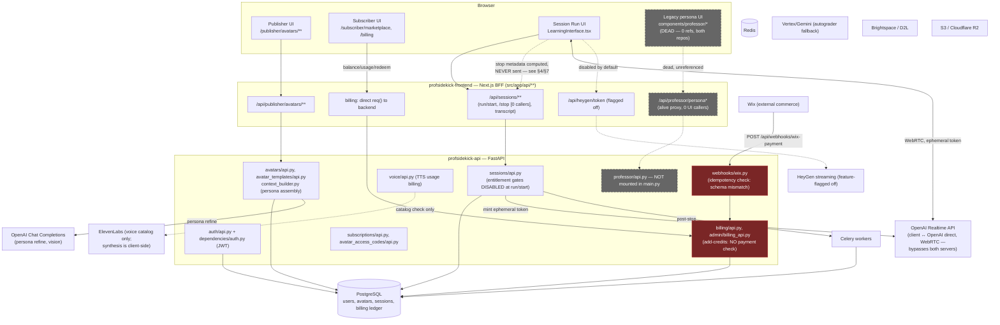

# ProfSidekick — Consolidated System Design Document

**Scope:** Both repos — `profsidekick-api` (backend, `backend-main/`, branch `staging`) and `profsidekick-frontend` (`profsidekick-frontend-main/`, branch `version2`).
**Method:** This is a consolidation of two independent, read-only Nexus-graph-grounded investigations (`backend-main/docs/SYSTEM_DESIGN.md` and `profsidekick-frontend-main/docs/SYSTEM_DESIGN.md`, both produced in this pass — treat those as the detailed per-repo evidence appendix; every claim below traces back to a citation in one of them). This document adds cross-repo reconciliation: it resolves open questions that one repo's findings answered for the other, and explicitly flags conflicts between the two investigations rather than silently picking a side.
**Not re-verified independently** — this pass did not re-run Nexus queries; it synthesizes the two prior passes and reasons about their intersection. Where the two disagree, both original claims are preserved and flagged (§9).

---

## 1. Executive Summary

ProfSidekick is a two-repo LMS-plus-AI-tutoring platform: a FastAPI backend (`profsidekick-api`) that owns essentially all business logic, persistence, and third-party integration, and a Next.js 15/React 19 frontend (`profsidekick-frontend`) that is almost entirely a thin BFF (backend-for-frontend) proxy layer with a 3D/voice runtime bolted on top. Three actor roles — publisher, subscriber, admin — are modeled as a single string column on one `User` table, not separate entities. Both repos independently show the same pattern: rapid, wave-by-wave feature growth (`W1A`…`W7` comment tags in the backend; a superseded-but-undeleted "professor persona" generation in the frontend) layered on an earlier design that was partially abandoned in place rather than removed.

The investigation **corrects one premise of the original brief**: the frontend does not contain hardcoded pricing, tiers, or entitlement logic. A full case-insensitive text search of the frontend source for `price|tier|plan|quota|limit|wix` found none, and the string "wix" does not appear anywhere in frontend code. All pricing (`PricingConfig`, `WIX_PRODUCT_CREDIT_MAP`), all credit accounting (`CreditBalance`, `UsageRecord`), and all three access-code systems live exclusively in the backend; the frontend only displays numbers the backend hands it. This is good news for the business's move to usage-based billing — it does not require untangling client-side business logic first.

A second cross-repo pattern, found in a follow-up trace after the initial pass, repeats the same shape: the backend built a genuine dual voice-provider pipeline (OpenAI native audio vs. ElevenLabs synthesis, including provider-aware billing) that the frontend's live session runtime never implements its half of — publisher-configured ElevenLabs voices are silently unreachable, and the interruption/barge-in mechanism would not work for that audio path even if it were reachable (§4.1a). This is a real, previously-undocumented product gap, not a security issue, but it directly blocks a named business requirement (client demand for customized, non-OpenAI voices).

The two investigations also combine into a more serious billing finding than either shows alone: **the mechanism that would make usage-based billing possible is broken on both ends of the same flow.** On the backend, the entitlement and credit-balance gates at the actual session-start mutation (`POST /api/sessions/{id}/run/start`) are explicitly disabled by comment — only a non-blocking advisory pre-check remains. On the frontend, the one call that would report session end (duration, and — if ever wired up — token usage) to the backend, `POST .../run/{run_id}/stop`, is defined end-to-end (proxy route + backend handler) but has **zero call sites anywhere in the UI** — the data is computed and then discarded at a callback boundary. Read together, this means: nothing currently stops an authenticated user from starting a session regardless of subscription/credits, and nothing currently closes out or bills a realtime AI session through any path either repo's traced UI exercises. Separately, a live, unauthenticated-in-effect credit-minting endpoint (`POST /api/billing/add-credits`) and a broken Wix-webhook idempotency check (schema/code mismatch) are both severe enough to treat as incidents rather than backlog (§7/§8).

---

## 2. Actors & Core Domain Model

*(Backend is authoritative for storage; frontend types are shown where they diverge from or duplicate the backend shape.)*

### 2.1 User / roles
Single `User` table (`backend-main: app/database/models/users.py`), `role` is a free-text column (`subscriber` default, `publisher`, `admin`), checked as a raw string in `app/dependencies/auth.py:76-105`. No separate `Publisher`/`Subscriber` entity exists. The frontend's route trees (`/admin`, `/publisher`, `/subscriber`) mirror this but enforce it only via a client-side redirect (`profsidekick-frontend-main: src/components/auth/ProtectedRoute.tsx:23-28`) that checks authentication, **not** role — role-based authorization is `[ASSUMPTION, unresolved]`: presumed backend-enforced per-route, not independently confirmed by either pass (§9).

### 2.2 AI Persona / Avatar — two parallel systems, confirmed dead on *both* sides
- **Live system** (both repos agree, wired end-to-end): backend `AvatarTemplate`/`AvatarTemplateVersion`/`AvatarTemplateRole` (admin-managed, versioned, immutable-per-version prompts) → publisher's `Avatar` (frozen to a `template_version_id` at creation) → `AvatarConfiguration` (voice/language/difficulty) → `PublisherAvatarProfile` (teaching-preference sliders + LLM-`refined_prompt`, the actual persona text — `backend-main: app/services/context_builder.py:183-213`) → `AvatarVariant`/`Avatar3DModel` (3D-model binding, plus dormant HeyGen ID fields). The frontend's `TeachingPreferences`/`PublisherAvatarProfile` types (`profsidekick-frontend-main: src/types/avatar.ts:144-229`) mirror this shape exactly and round-trip through backend-persisted API calls (`avatarApi.create()`, `configApi.upsert()`) — no client-only persistence for anything that affects session behavior, with one explicitly-labeled exception (§4.1).
- **Dead system, now confirmed dead end-to-end**: backend's `ProfessorPersona` model (`app/database/models/legacy.py:18-30`) and its `app/api/professor/api.py` router are never mounted in `app/main.py` (zero `include_router` reference) — this is not just unused, it is **HTTP-unreachable regardless of client**. The frontend's matching subsystem (`useProfessorPersona.ts`, `src/components/professor/*`) independently shows zero incoming references via Nexus `context()`/`impact()`. **This resolves the frontend SDD's open question #3** ("are these backend routes still called by any other client?") — no: they are not mounted, so no client anywhere can reach them. Safe to delete on both sides as one coordinated cleanup.

### 2.3 Session
Backend: `Session` (course-scoped: slides JSONB, `session_mode`, `is_published`) and `SessionRun` (one realtime attempt: `status`, `start_time`/`end_time`, frozen `variant_snapshot`). **Neither has a token-count or cost column** — cost lives entirely in the separate billing model family (§2.4), joined only via a nullable `UsageRecord.session_run_id`.

Frontend: the same concept is represented by **three overlapping, inconsistently-cased types** — `ClassSession`/`ClassDetails` (explicitly commented "Legacy … will be removed" yet is the type actually constructed on both live session-run pages) and `SessionDetails`/`SessionRunDetails` (the newer type, effectively unused on the live path). This is a frontend-only maintenance hazard with no backend-side counterpart — the backend schema is not itself duplicated, only the frontend's in-memory representation of it.

### 2.4 Billing / Credit Ledger
Entirely backend-owned (`backend-main: app/database/models/billing.py`): `CreditBalance` (one row/user), `UsageRecord` (the real metering row — tokens, `raw_cost_usd`, `platform_fee_usd`, `total_cost_usd`, `credits_charged`), `PricingConfig` (per-`operation_type` cost-plus rate table, admin-tunable live via `PATCH /api/admin/billing/pricing/{operation_type}`), `ProcessedWixOrder` (Wix webhook idempotency guard — see §7 for a schema/code mismatch), `AutoTopUpSettings` (defined, consumer not located — unresolved, §9). Three separate, overlapping code-redemption systems exist: platform-wide `AccessCode`, avatar-scoped `AvatarAccessCode`, course-scoped `CourseAccessCode` — all three have live, mounted routes on the backend side; the frontend consumes all three via `bffReq` calls with no client-computed values (`profsidekick-frontend-main: src/lib/avatarApi.ts:221-241`, billing page). **This resolves the backend SDD's flagged "possible frontend duplication" item (backend §6, last row)**: confirmed, no duplication — the frontend is a pure consumer.

### 2.5 Course / Program
Backend-only concept in this pass: `Course` → `CourseMaterial`, `CourseStudent` (enrollment), `CourseAccessCode`; `Program` bundles avatars + courses. Frontend surfaces these through backend-driven marketplace/enrollment UI without an independent model of its own.

---

## 3. High-Level Architecture

**Backend**: FastAPI 0.104 + Uvicorn, SQLAlchemy 2.0 + Alembic (87 migrations) on PostgreSQL, Redis (session cache + Celery broker), Celery 5.3 (async post-session work).
**Frontend**: Next.js 15 App Router + React 19 + TypeScript, Tailwind + Radix UI, Three.js/`@react-three/fiber`/`drei` for GLB 3D avatars, `@heygen/streaming-avatar` (feature-flagged **off** by default), `openai` SDK for the WebRTC realtime client.
**Integration pattern**: virtually every frontend domain read/write is a Next.js Route Handler (`src/app/api/**`) proxying to the FastAPI backend with the caller's Bearer token — the frontend holds almost no independent business logic (confirmed §1, §5).
**Realtime AI path bypasses the backend entirely**: the backend mints a short-lived OpenAI ephemeral token; the actual voice conversation runs **client ↔ OpenAI directly over WebRTC**. Neither repo's backend nor frontend server code observes token usage from this leg — it is architecturally outside both applications' server-side visibility (§4.2, §5).

### Combined component/service topology

---

## 4. Key Flows (end-to-end, both repos)

### 4.1 Persona / avatar customization
Publisher wizard (`profsidekick-frontend-main: src/app/publisher/avatars/new/page.tsx`) → `avatarApi.create()` (bffReq) → backend `POST /api/publisher/avatars` (`avatars/api.py:87-108`, freezes `template_version_id`) → variant/3D-model binding (`POST .../variants`) → configuration (`POST/PUT .../configuration`) → persona refine (`POST .../profile/refine`, calls OpenAI `gpt-4o-mini`, upserts `PublisherAvatarProfile.refined_prompt`) → publish. At runtime, `context_builder.py:171-213` assembles the realtime system prompt from the template's mode-resolved prompt + `refined_prompt`. **One genuine client-only stub exists and is self-documented as such**: a "Post-Session Check" toggle in the frontend wizard (`src/app/publisher/avatars/new/page.tsx:122,329-346`) is explicitly commented `// UI-only, not sent to backend yet` and has no backing field in `AvatarCreate`/`TeachingPreferences` on either side.

**Voice provider selection is a half-built dual pipeline — the single biggest configuration gap found in this pass.** The backend implements real multi-provider voice resolution: `AvatarConfiguration.tts_provider`, `voice_resolution_service.resolve_session_voice()` (backend `app/services/voice_resolution_service.py:46-96`, subscriber-preference override → publisher default, with backward-compat provider inference), and provider-aware billing (`PricingConfig` rates for `tts_openai` and `tts_elevenlabs`). The ephemeral-token endpoint's own code comment (`sessions/api.py:1521-1526`) states the intended design explicitly: OpenAI Realtime plays audio natively only for `provider=="openai"`; for anything else, "the frontend runs Realtime in text-only mode and synthesises separately." **The frontend never built that half.** Its only voice-selection UI (`configure/page.tsx:17,122-127`) offers exclusively the 8 native OpenAI voice names; no live session component (`TeachingInterface.tsx`, `LearningInterface.tsx`, `sessionService.ts`, `avatarConfig.ts`) reads the backend's `voice_provider` field; `TeachingInterface.tsx:1130-1134` unconditionally requests `modalities: ["text","audio"]` from OpenAI regardless of the resolved provider. A working ElevenLabs synthesis module exists (`src/app/api/tts/elevenlabs/route.ts`) but is wired only to a standalone voice-preview feature, not the live runtime. **Failure mode**: an avatar resolved to an ElevenLabs voice is still billed correctly at the `tts_elevenlabs` rate, but the learner silently hears OpenAI's default voice instead — no error, just the wrong voice. This also has a downstream architectural consequence: barge-in/interruption (`realtimeInterrupt.ts:interruptActiveResponse`) works exclusively through OpenAI Realtime's own WebRTC data-channel messages (`response.cancel`, `output_audio_buffer.clear`, `conversation.item.truncate`); it would not stop a separately-played ElevenLabs audio stream, so completing this pipeline requires a second, independent interruption mechanism — a genuine voice-activity-detection-driven "learner starts speaking → stop the avatar's current audio, whatever its source, and listen" capability that does not exist today for any non-OpenAI-native audio path. The same integration-shape gap likely extends to HeyGen (currently fed OpenAI's own audio/text feed, per §3), which would need to consume an ElevenLabs stream instead under a completed design — flagged as an architectural risk by inference (HeyGen is feature-flagged off and was not re-traced in this follow-up), not a directly confirmed code finding.

### 4.2 Subscriber session — what's tracked, what's not (the central combined finding)
1. Frontend eligibility pre-flight (`GET /api/sessions/{id}/eligibility`) returns `{eligible, issues[]}` with typed codes; if ineligible, frontend blocks with `EligibilityBlock` and never calls `run/start` — a real server round-trip, **but the backend's own docstring for this same endpoint states the underlying gates (enrollment, published-only, avatar subscription) are "temporarily disabled" and only the credit-floor check remains, and that check is advisory** (nothing blocks the subsequent start call even if it fails).
2. `POST /api/sessions/{id}/run/start` — backend comment at `sessions/api.py:747-749` states **all** subscriber gates, including the credit-balance check, are "temporarily disabled." The frontend's own `src/lib/api.ts` documents that the backend can return HTTP 402 "Insufficient Credits" from this call — **this is a direct discrepancy between the two repos' evidence, not resolved by either pass; see §9.**
3. `GET /api/session/ephemeral` mints a short-lived OpenAI token; from here the conversation runs client↔OpenAI directly, invisible to both application servers.
4. During the session, transcript turns are persisted live (`useTranscriptPersistence.ts` → `POST .../transcript`) — confirmed real telemetry reaching the backend.
5. **On session end**, the frontend computes `session_duration_minutes` and feedback client-side (`LearningInterface.tsx:1140-1171`) and passes it to `onEndSession(metadata)` — but **both call sites that implement `onEndSession` discard the argument and just navigate away** (`.../run/[runId]/page.tsx:71-73`, `.../run/page.tsx:165-167`). `config.api.sessions.runStop` and its backing proxy routes exist and correctly forward to the backend `POST .../run/{run_id}/stop` when invoked — but have **zero call sites anywhere in the frontend**.
6. On the backend, that same `stop` endpoint is where realtime usage billing actually happens: it accepts **client-self-reported** `input_tokens`/`output_tokens` in the request body (its own docstring says so) and synchronously calls `billing_service.charge_usage(operation_type="session_run", ...)`.

**Combined conclusion, visible only by reading both repos together**: the endpoint that would both (a) charge credits for realtime AI usage and (b) record a definitive session end/duration is never called by any traced frontend code path, while the endpoint that starts a session enforces no entitlement or balance check at all. Along the UI paths both investigations traced, a session-run's cost is neither gated on entry nor billed on exit. TTS/voice usage billing (`POST .../voice-usage`, per-utterance character count) is a separate, structurally-measured call site on the backend — but **whether the frontend actually calls it was not confirmed by either pass** (§9).

### 4.3 Payment / billing (Wix)
Wix Automation → `POST /api/webhooks/wix-payment` (backend only; shared-secret header, **defaults to accepting unauthenticated requests if `WIX_WEBHOOK_SECRET` is unset**) → idempotency check against `ProcessedWixOrder` (**broken — see §7**) → buyer matched to `User` by email → line items mapped through `WIX_PRODUCT_CREDIT_MAP` (fixed SKU → fixed credit block; this is the entire "package" model, no metering, no proration) → `billing_service.add_credits`. **The frontend has zero Wix code, SDK references, or checkout UI of any kind** (confirmed by full-text search of `src/`) — this resolves the frontend SDD's open question "is Wix used anywhere in this repo" (no), but raises a still-open question about where the actual purchase/checkout experience lives, since neither repo contains it (§9).

---

## 5. Payments & Billing — Current State vs. Target, Cross-Repo View

**This is the highest-priority cross-reference finding requested by the consolidation brief, stated plainly: there is no pricing or entitlement duplication between the two repos, because the frontend has none at all.** Every dollar/credit figure a user sees (`credits_per_session`, `balance`, `credits_used`, access-code `credits_per_user`) is backend-supplied and the frontend only formats it. The only frontend-side numeric "limit" found was a UI pagination page size (`LIMIT = 20`, billing page) — not an entitlement. This directly contradicts the brief's premise that pricing rules were suspected to be hardcoded client-side; they are not, in either repo's evidence.

**What this means for the target model**: moving to usage-based billing is architecturally a **backend-only change** — the frontend already treats every billing number as an opaque value to render, so no client-side business-logic untangling is required first. What blocks it instead:

1. **No trustworthy usage signal exists for the dominant cost driver.** Realtime AI tokens are self-reported by the client at a `/stop` call that, per §4.2, is never actually made from the traced UI. Even if that call site is fixed, the values it would send remain client-computed and unverified against the AI provider.
2. **No infrastructure/server cost accounting exists anywhere in either repo** — the "(b) server/infrastructure subscription cost" input for the business's 40%-margin target has no in-code representation on either side; it would have to come from the hosting provider's own billing (backend repo shows `fly.toml`/`railway.json`/`Procfile` at its root, i.e. Railway/Fly.io), external to both codebases.
3. **Whether Wix's platform supports metered/usage-based billing at all is [UNVERIFIED]** — neither repo can answer this; it requires research against Wix's actual product/API capability, outside the scope of a code investigation. Today, only fixed-package webhook handling is implemented.
4. A real cost-plus formula already exists and is admin-tunable without a deploy (`PricingConfig`, backend `billing_service.py:86-130`, seeded rates in migrations `o6j7k8l9m0n1` and `v9tts0004`) — this is a usable rate-table foundation once the input-data gap above is closed. It is not something that needs to be built from scratch.

---

## 6. Technical Debt & Findings Catalog (merged, source-tagged)

| Repo | Location | Issue | Evidence | Severity |
|---|---|---|---|---|
| **Both** | `sessions/api.py:747-749` (backend) + `run/[runId]/page.tsx:71-73`, `run/page.tsx:165-167` (frontend) | **Combined billing/entitlement gap**: backend disables all entry gates at `run/start`; frontend never calls the `stop` endpoint that would bill/finalize a run. Along traced UI paths, sessions are neither gated on entry nor billed/closed on exit. | See §4.2 synthesis. | **Critical** |
| Backend | `app/api/billing/api.py:77-94`, `AddCreditsRequest` schema | `POST /api/billing/add-credits` lets any authenticated user self-credit an arbitrary amount with **zero payment verification** — no receipt/token/admin gate. | Direct read of route + schema (one field: `amount_usd`, no payment reference). | **Critical** |
| Backend | `app/api/webhooks/wix.py:182-183,281-287` vs `app/database/models/billing.py:98-108` | Wix webhook idempotency check/insert reference `ProcessedWixOrder.wix_order_id`; the ORM model only defines `order_id`. Will raise on essentially every webhook delivery as written. | Model/migration/code cross-read; migration `c2222222222c` created `wix_order_id` (matches code, not model). | **Critical** |
| Backend | `sessions/api.py:143-144, 384-388, 747-749` | Subscriber entitlement gates (enrollment, published-only, avatar subscription, credit balance) explicitly disabled by comment at three call sites. | Direct quotes in backend SDD §4.2. | **High** |
| Frontend | `src/lib/config.ts:33` (`runStop`) + 3 proxy routes | Session-stop write path fully implemented (helper + BFF proxy) but zero call sites in the UI. | `route_map()` consumers: `[]`; text search confirms. | **High** |
| Frontend | `.../run/[runId]/page.tsx:71-73`, `.../run/page.tsx:165-167` | `onEndSession(metadata)` receives session-end data (duration, feedback) and discards it. | Direct read. | **High** |
| Backend | `billing_service.charge_usage` + `voice/api.py:259-267`, `sessions/api.py:929-930` | All billing inputs (tokens, TTS character count) are client-self-reported, not measured or reconciled server-side. | §4.2/§5 citations. | **High** |
| **Both** | Backend: `voice_resolution_service.py:46-96`, `sessions/api.py:1500-1526,1682-1689`. Frontend: `configure/page.tsx:17,122-127`, `TeachingInterface.tsx:1130-1134`, `realtimeInterrupt.ts:21-42` | **ElevenLabs voice pipeline half-built**: backend resolves provider and bills correctly for it; frontend's voice picker offers only OpenAI voices, no live session component reads `voice_provider`, and audio modality/interruption handling is hardcoded to OpenAI-only. Publisher-configured non-OpenAI voices silently never reach the learner. | See §4.1 synthesis. | **High** |
| **Both (resolved dead)** | Backend: `app/api/professor/api.py`, `legacy.py:18-30`. Frontend: `useProfessorPersona.ts`, `src/components/professor/*` | Entire legacy persona subsystem confirmed dead on both ends — backend router never mounted (HTTP-unreachable), frontend has zero UI entry points. | Backend: no `include_router` match in `main.py`. Frontend: `context()`/`impact()` show 0 refs. | Medium (safe coordinated removal) |
| Frontend | `src/constants/examinerPrompt.ts` (`USE_FRONTEND_EXAMINER_MODE = true`) | A flag literally designed to force a frontend-owned prompt "regardless of backend prompt state" — currently unwired/dead, but exactly the anti-pattern the brief asked to hunt for. | `context()`: 0 refs; not imported anywhere. | Medium (dead) / would be High if ever wired up |
| Backend | Three access-code systems (`AccessCode`, `AvatarAccessCode`, `CourseAccessCode`) | Overlapping redeem-for-entitlement logic implemented three separate times, three separate services. All live and reachable — not dead, but duplicated. | Route map: 3 mounted routers. | Medium |
| Frontend | `src/types/types.ts:62-150` | Three overlapping session type families; the one commented "Legacy … will be removed" is the one actually in production use. | Direct read of both live run pages. | Medium |
| Backend | `app/main.py:107-125` OpenAPI description | Publicly-visible (`/docs`) claim "this API does not require authentication" is false — JWT bearer auth is implemented and used almost everywhere. | Direct read vs `dependencies/auth.py`. | Low |
| Frontend | `README.md` (repo root) | Describes a materially different, pre-auth 2-page MVP that no longer matches the current multi-actor authenticated app. | Direct read, contradicted by live route structure. | Medium (onboarding/documentation risk) |
| Backend | `app/database/models/billing.py:112-124` (`AutoTopUpSettings`) | Model exists; no consuming service/route located in this pass. | Grep across `services/`, `api/` found only the model + `__init__` import. | Low–Medium (unconfirmed, not proven dead) |
| Frontend | `ProtectedRoute.tsx:23-28` | Checks authentication only, no role check, before rendering role-scoped route trees. | Direct read. | Low–Medium (depends on unresolved backend-role-check assumption, §9) |
| Frontend | `src/lib/avatarApi.ts` | Two parallel request helpers (`req()` direct-to-backend, `bffReq()` via own proxy) used inconsistently for related endpoint families. | Direct read. | Low |
| Backend | Guest session flow (`/run/start/guest`, `/run/stop/guest`) | Bypasses `current_user` auth via a shared `GUEST_USER_UUID`; billing implications not fully traced. | `sessions/api.py:838`, commented-out `Depends`. | Unresolved — see §9 |

---

## 7. Open Questions / Assumptions Log (reconciled)

**Resolved by cross-referencing the two passes** (removed from "open," recorded here for traceability):
- ~~Does the frontend independently compute session cost/pricing/entitlement logic?~~ **No** — confirmed absent by full-text search (§5).
- ~~Are the `/api/professor/persona*` backend routes still used by any other client?~~ **No** — the backend router is never mounted, so it is unreachable by any client, not just this frontend (§2.2).
- ~~Is Wix used anywhere in the frontend repo?~~ **No** — confirmed absent; Wix touches only the backend webhook (§4.3). (Still open: where the actual checkout UI lives — see below.)
- ~~Does `Avatar.subscription_cost`/access-code pricing get duplicated or independently computed on the frontend?~~ **No** — frontend only displays backend-supplied values (§2.4).

**Still open** (neither pass could resolve; some sharpened by the cross-reference):
1. **Where does the actual Wix checkout/purchase UI live?** Neither repo contains one. Either it's an external Wix-hosted page outside both indexed repos, or the integration model has changed since the brief was written. Needs a business-side answer, not a code answer.
2. **`ProcessedWixOrder.order_id` vs `wix_order_id`** — which name actually exists in the live production database is unresolvable from source/migration history alone (possible undocumented manual schema change). Needs a direct DB check.
3. **Is `WIX_WEBHOOK_SECRET` actually set in production?** Code tolerates it being unset (with only a log warning). Ops question, not resolvable from source.
4. **`AutoTopUpSettings` consumer** — not located in the backend pass; frontend pass doesn't mention it at all either. Needs a targeted follow-up query.
5. **Is `POST .../voice-usage` (TTS character-count billing) actually called by the frontend?** Backend confirms the endpoint and its billing effect exist; frontend's pass did not confirm or deny a call site for it. Same risk class as the confirmed-broken `stop` call — needs explicit tracing.
6. **Role-based authorization enforcement**: frontend's only role gate is a client-side redirect with no role check at all (not even client-side); backend is assumed (not verified in either pass) to re-check role/ownership server-side on every `/api/admin/**`/`/api/publisher/**` call. This assumption is now the single point on which the entire role-isolation model rests, per both docs — worth a dedicated, targeted verification pass.
7. **Guest session billing** — whether/how credit billing applies to the shared-GUID guest session flow was not fully traced in either pass.
8. **Wix metered-billing capability** — a Wix product/API research question, not answerable from either codebase.

---

## 8. Cross-Repo Discrepancies

Per the consolidation instructions, these are **not resolved** — both original claims are preserved so nothing is silently dropped:

1. **Conflicting claims about credit-balance enforcement at session start.** The frontend SDD states (§4.2, §5) that "credit sufficiency is backend-enforced... not a client-only bypassable gate," citing `src/lib/api.ts`'s documentation that the backend returns HTTP 402 "Insufficient Credits" on `run/start`. The backend SDD states (§4.2, quoting `sessions/api.py:747-749` directly) that the credit-balance check — along with every other subscriber gate — is explicitly "temporarily disabled" at that exact endpoint. These cannot both be currently true of the same code path. Possible explanations neither pass could confirm: the frontend's `api.ts` comment documents intended/historical behavior that is now stale; the 402 response comes from a different, unexamined code path; or one of the two source reads is looking at a different branch/version than assumed. **This needs a direct, targeted re-check of `sessions/api.py`'s current `run/start` handler before either claim is trusted for a security or billing decision.**
2. **Wix integration touchpoint scope.** The original task brief assumes "payments currently implemented through Wix" in a way that implies visible checkout/package UI. The backend confirms a real, live webhook handler; the frontend confirms zero Wix presence of any kind, including no checkout redirect. Both are individually well-evidenced, but together they leave the actual purchase flow's location unaccounted for by either repo — flagged as an open question (§7) rather than assumed to be "out of scope" or "not built yet," since the backend clearly expects orders to arrive.

---

## 9. Recommendations

*(Priority-ordered, non-implementation-committing, synthesized across both repos' recommendations.)*

1. **Treat as incidents, not backlog**: close the unauthenticated `/api/billing/add-credits` credit-minting gap, and verify the `ProcessedWixOrder` schema against the live production database (the webhook's idempotency guard is confirmed broken as written).
2. **Resolve the discrepancy in §8, item 1, before making any billing/security decision that depends on whether `run/start` enforces credit balance** — this is a factual question about current code behavior, not a judgment call, and the two prior passes disagree.
3. **Decide explicitly whether the disabled subscriber gates are intentional** (e.g., temporary open-beta posture) and, regardless, **fix the session-stop call path** so realtime sessions are actually closed out and billed — these two gaps together mean the platform currently has neither reliable access control nor usage capture for its core paid product surface.
4. **Before evaluating any usage-based pricing model**, instrument server-side or provider-verified usage measurement for realtime tokens and TTS characters; confirm whether `/voice-usage` is even called today (§7, item 5) — self-reported client data cannot support a trustworthy cost-plus price even after the stop-path gap is fixed.
5. **Research Wix's actual metered/usage-based billing capability**, and separately, **get a business-side answer on where checkout actually happens** (§8, item 2) — both are prerequisites for deciding between a Wix-native metered integration and a custom tier system.
6. **Delete the legacy "professor persona" subsystem on both repos as one coordinated cleanup** — it is now confirmed fully dead (unreachable backend router + zero frontend references), which was not knowable from either repo alone.
7. **Remove `USE_FRONTEND_EXAMINER_MODE`/`EXAMINER_BASE_PROMPT`** rather than leaving it as a dead-but-loaded anti-pattern that could be wired back in.
8. **Consolidate the three backend access-code systems** and **the frontend's overlapping session type families** before building new pricing/tier UI on top of either — both are real, live, non-dead duplication that will compound if a new billing model is layered on without cleanup first.
9. **Run a dedicated verification pass on role-based authorization** (§7, item 6) — both docs independently flag this as resting entirely on an unverified assumption about backend-side enforcement, since the frontend's route guard provides no security boundary by itself.
10. **Scope the ElevenLabs voice pipeline as a real design task, not a UI tweak, if non-OpenAI voice support is still a business requirement** (§4.1, §6) — the backend investment is already built and billed; closing this gap needs (a) an ElevenLabs option in the publisher voice picker, (b) live session components that branch on `voice_provider` to run OpenAI text-only + synthesize/play ElevenLabs audio separately, and (c) an independent, voice-activity-detection-driven barge-in mechanism for that separately-played audio, since the current interrupt code is OpenAI-WebRTC-specific. Decide first whether this is still wanted before investing further, since the current state is a silent wrong-voice bug rather than a missing feature users are blocked on loudly.
11. **Lower-priority hygiene**: fix the backend's stale "no auth required" OpenAPI description; rewrite the frontend's stale MVP-era README; confirm whether `AutoTopUpSettings` is dead code before wiring it up or removing it; trace the guest-session billing path.
