# ProfSidekick — UML Implementation Diagrams

All diagrams use [Mermaid](https://mermaid.js.org/) syntax and render natively in VS Code (with the Markdown Preview Mermaid Support extension), GitHub, and most modern markdown viewers.

---

## 1. System Component Architecture

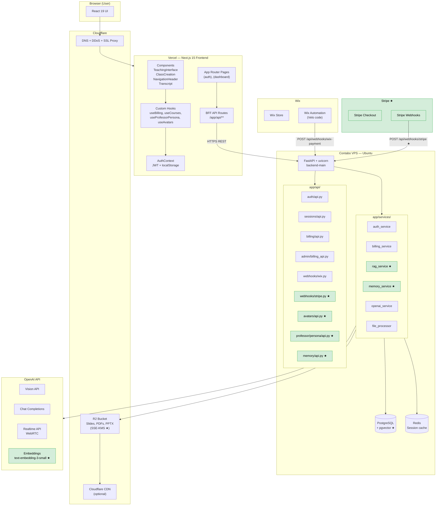

> **Legend:** Green = new (to be built) · Blue = existing

---

## 2. Full Database Entity-Relationship Diagram

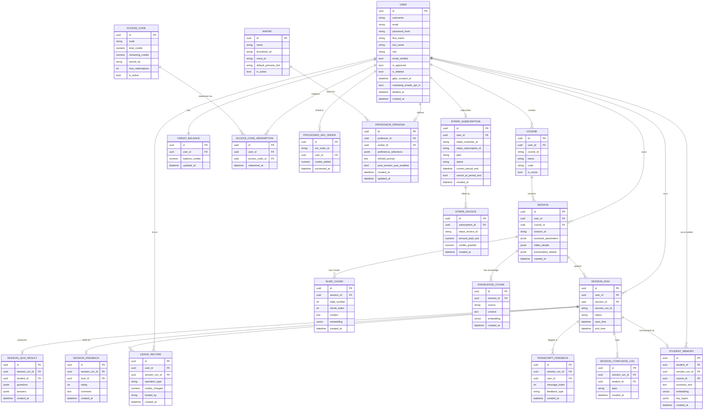

---

## 3. Frontend Component Hierarchy

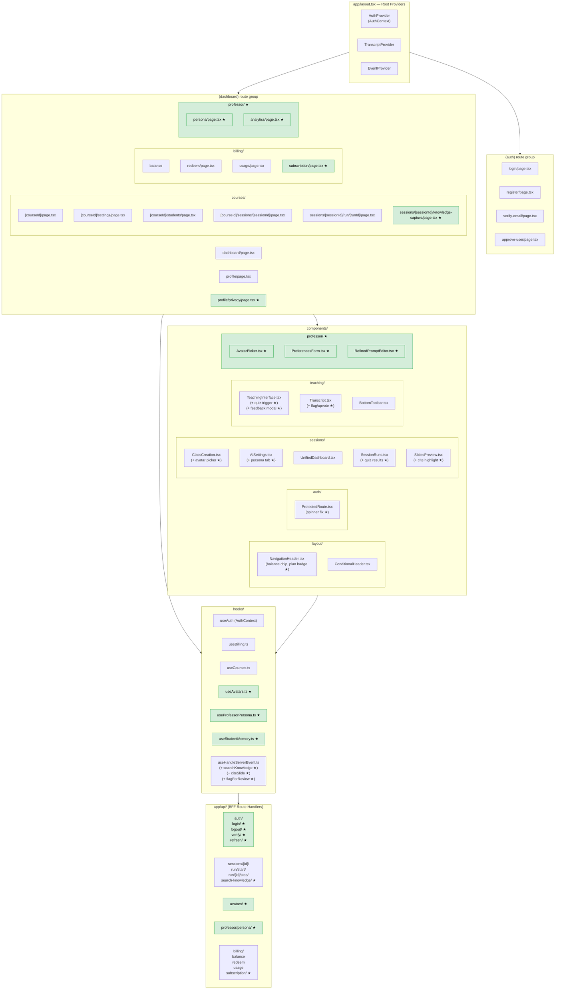

---

## 4. Sequence: Authentication Flow (Fixed — BFF Pattern)

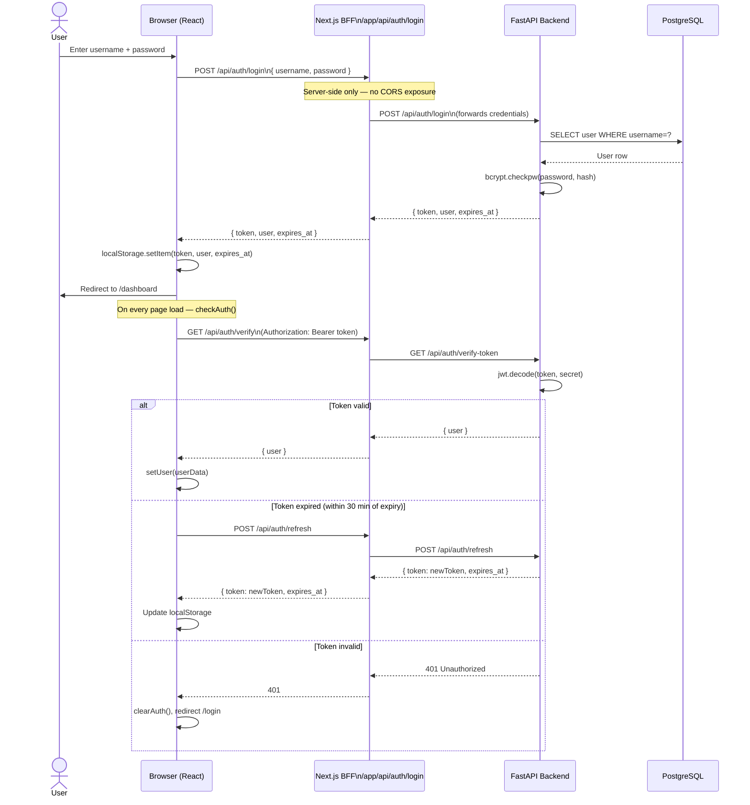

---

## 5. Sequence: RAG Ingestion Pipeline (File Upload)

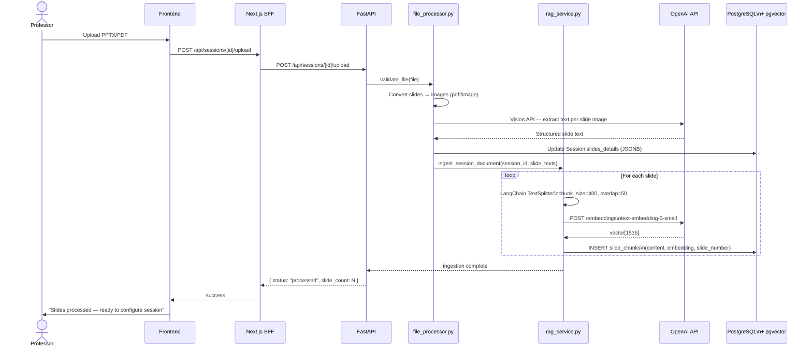

---

## 6. Sequence: Live Session (Student Experience with RAG + Memory)

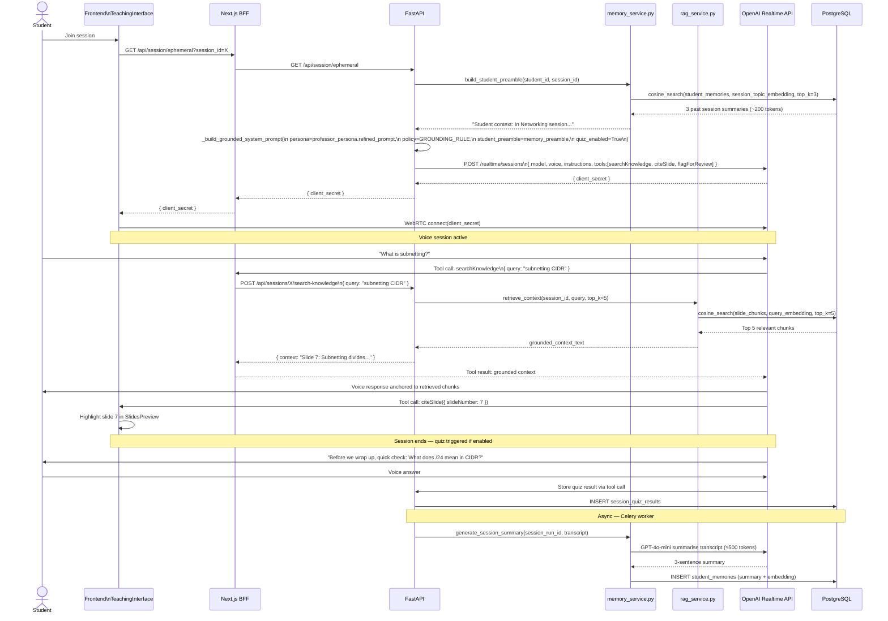

---

## 7. Sequence: Professor Persona Setup

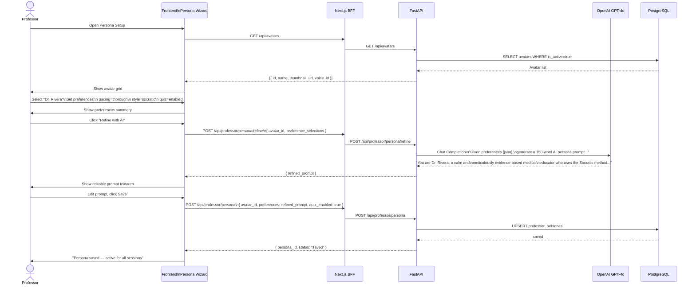

---

## 8. Sequence: Student Feedback Loop → Persona Refinement

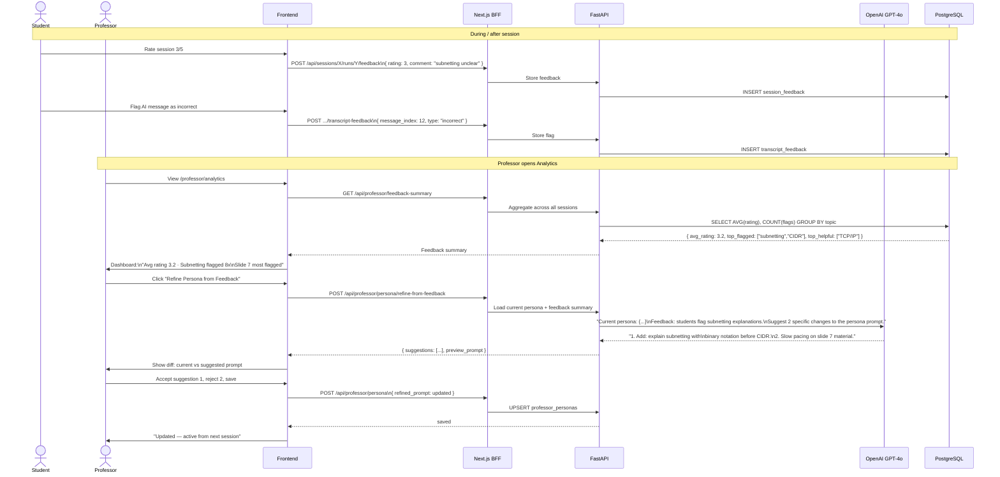

---

## 9. Sequence: Stripe Subscription Checkout

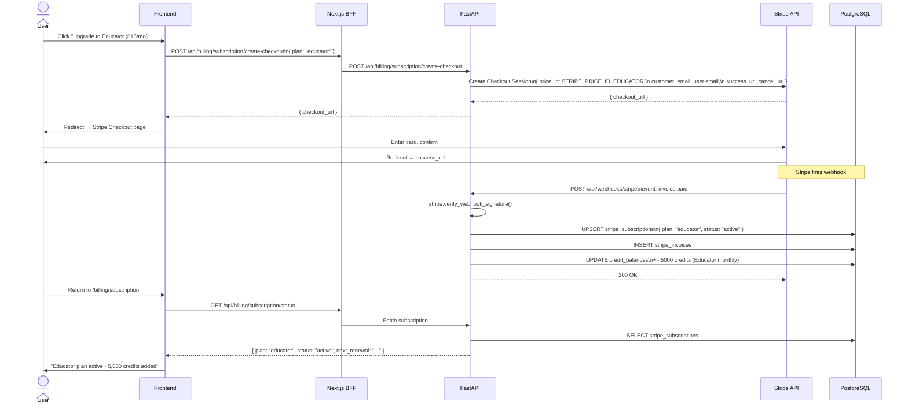

---

## 10. Backend Service Dependency Map

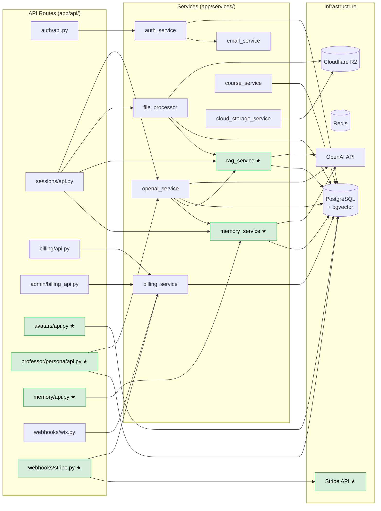

---

## 11. GDPR Data Flow

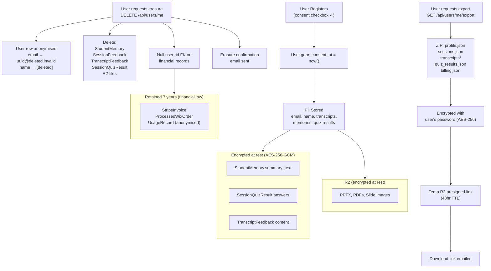

---

## 12. Phase Delivery Summary

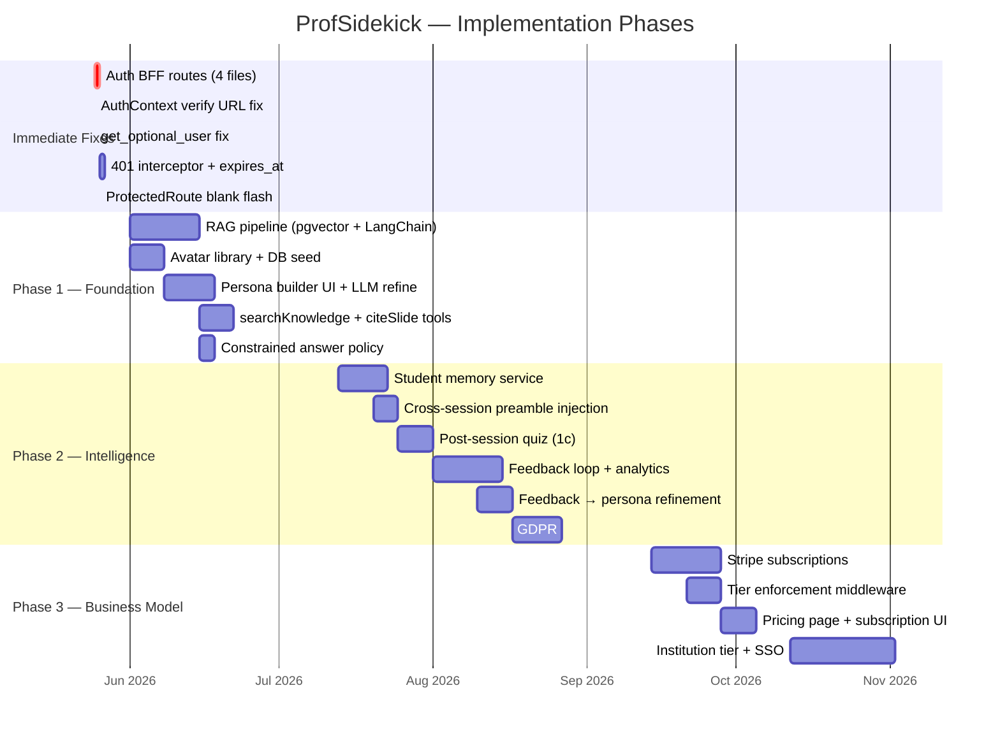
